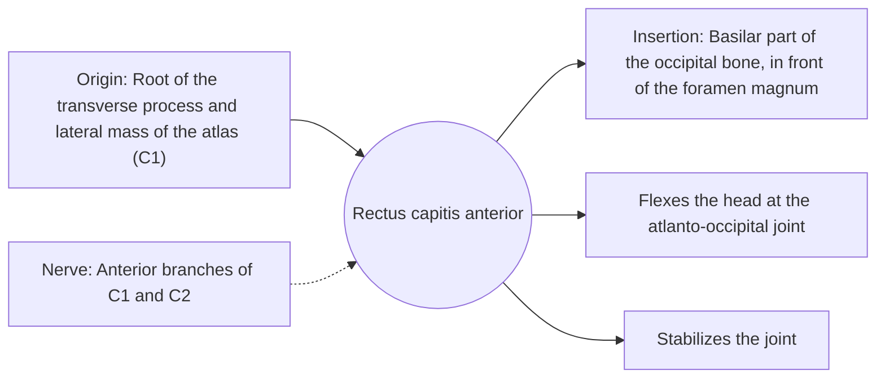

# Rectus capitis anterior

## Summary

The rectus capitis anterior is a small, quadrilateral prevertebral muscle that is sometimes hard to find. It runs from the atlas to the base of the occipital bone and flexes the head at the atlanto-occipital joint.

## Prerequisites

- [Muscular system overview](../muscular-system-overview.md)
- [Neck](../../regions/neck.md)

## Core concepts

### Definition

The *rectus capitis anterior* is a short, flat muscle deep to the longus capitis, connecting the front of the atlas to the skull base.

### Analogy

This muscle is like a short strap at the front of a hinge, pulling the head into a small nod. The analogy breaks because it is too small to move the head forcefully and works mainly as a stabilizer and position sensor.

### Mechanism

Short deep muscles near the skull base contain many muscle spindles and contribute to the sense of head position (proprioception).

The diagram shows the attachments, the nerve and the actions.

### Attachments and innervation

| Feature | Description |
| --- | --- |
| Latin name | *musculus rectus capitis anterior* |
| Origin | Root of the transverse process and lateral mass of the atlas (C1) |
| Insertion | Basilar part of the occipital bone, in front of the foramen magnum |
| Innervation | Anterior branches of C1 and C2 |
| Actions | Flexes the head at the atlanto-occipital joint; Stabilizes the joint |

## Worked example

Chin-tuck exercises ("make a double chin") activate the deep upper neck flexors, including this muscle and the longus capitis, which help counter a forward head posture.

## Trade offs and when to use it

Small but rich in proprioceptors.

## Common mistakes

- **Expecting to palpate it.** It lies deep in front of the upper cervical spine and cannot be felt.

## Practice

1. What does the rectus capitis anterior do?
2. Where does it originate?

### Answers

1. It flexes the head at the atlanto-occipital joint.
2. On the atlas.

## Further reading

- Standring, S. (Ed.) (2020). *Gray's Anatomy: The Anatomical Basis of Clinical Practice (42nd ed.)*. Elsevier. Reference text for attachments, innervation and relations.
- Betts, J. G., Young, K. A., Wise, J. A. et al. (2022). *Anatomy and Physiology 2e*. OpenStax, Rice University. [Link](https://openstax.org/details/books/anatomy-and-physiology-2e). Open textbook with illustrations of the skeletal and muscular systems.
