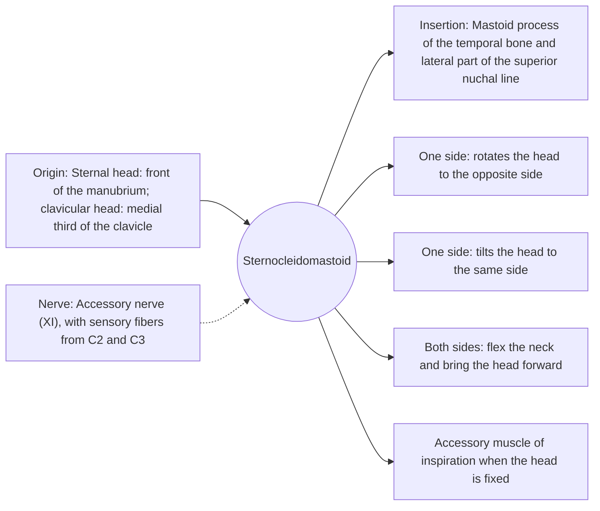

# Sternocleidomastoid

## Summary

The sternocleidomastoid (SCM) is a strong, superficial neck muscle running from the sternum and clavicle to the mastoid process behind the ear. It stands out clearly when the head turns. One muscle turns the head to the opposite side and tilts it to the same side; both together flex the neck. It divides the neck into the anterior and lateral triangles.

## Prerequisites

- [Muscular system overview](../muscular-system-overview.md)
- [Neck](../../regions/neck.md)

## Core concepts

### Definition

The *sternocleidomastoid* has two heads, sternal and clavicular, which join and run up and back to the mastoid process. In clinical practice it is often abbreviated SCM. It is one of the main landmarks of the neck.

### Analogy

The two sternocleidomastoids are like the two guy ropes of a mast set diagonally: pulling one rope turns and tilts the mast, pulling both together bows it forward. The analogy breaks because when the head is tilted back, both muscles can help extend the head at the upper neck.

### Mechanism

Because it attaches behind the axis of the atlanto-occipital joint, it can extend the head on the neck while flexing the neck on the trunk. When the head is fixed, it lifts the sternum, so it acts as an accessory breathing muscle during heavy breathing or in lung disease.

The diagram shows the attachments, the nerve and the actions.

### Attachments and innervation

| Feature | Description |
| --- | --- |
| Latin name | *musculus sternocleidomastoideus* |
| Origin | Sternal head: front of the manubrium; clavicular head: medial third of the clavicle |
| Insertion | Mastoid process of the temporal bone and lateral part of the superior nuchal line |
| Innervation | Accessory nerve (XI), with sensory fibers from C2 and C3 |
| Actions | One side: rotates the head to the opposite side; One side: tilts the head to the same side; Both sides: flex the neck and bring the head forward; Accessory muscle of inspiration when the head is fixed |

### Landmarks

The SCM separates the anterior triangle of the neck (in front) from the lateral (posterior) triangle (behind). The internal and external carotid arteries can be traced by extending the line of the SCM up to the angle of the mandible, and the internal jugular vein runs beneath it.

### Exercises and tests

Turning the head against the resistance of a hand placed on the opposite cheek makes the SCM stand out. Neck flexion exercises with the chin tucked train it with the deep flexors.

## Worked example

In congenital muscular torticollis, a shortened SCM in an infant tilts the head to the affected side and turns the chin to the opposite side, exactly the combined action of one SCM. Gentle stretching started early corrects most cases.

## Trade offs and when to use it

Strong and superficial, it gives a strong lever for head movement. In people with breathing difficulty, its use as an accessory breathing muscle is a visible sign of effort.

## Common mistakes

- **Saying the right SCM turns the head to the right.** It turns the face to the left (opposite side) and tilts the head to the right.

## Practice

1. Which nerve supplies the SCM?
2. A person turns the face to the left. Which SCM is contracting?
3. What does the SCM separate?

### Answers

1. The accessory nerve (XI).
2. The right SCM.
3. The anterior and lateral triangles of the neck.

## Further reading

- Standring, S. (Ed.) (2020). *Gray's Anatomy: The Anatomical Basis of Clinical Practice (42nd ed.)*. Elsevier. Reference text for attachments, innervation and relations.
- Betts, J. G., Young, K. A., Wise, J. A. et al. (2022). *Anatomy and Physiology 2e*. OpenStax, Rice University. [Link](https://openstax.org/details/books/anatomy-and-physiology-2e). Open textbook with illustrations of the skeletal and muscular systems.
