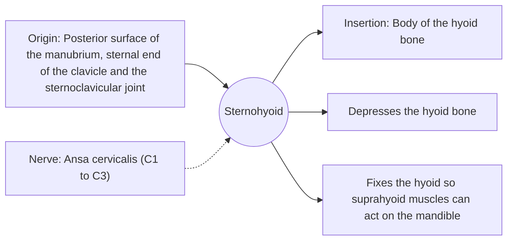

# Sternohyoid

## Summary

The sternohyoid is a strap-like infrahyoid muscle, about 1.5 to 2 cm wide, running from the chest up to the hyoid bone. It pulls the hyoid down after swallowing.

## Prerequisites

- [Muscular system overview](../muscular-system-overview.md)
- [Neck](../../regions/neck.md)

## Core concepts

### Definition

The *sternohyoid* is the most superficial of the infrahyoid ("strap") muscles, on the front of the neck beside the midline.

### Analogy

The sternohyoid is like a ribbon tied from the breastbone to a toggle (the hyoid): pulling it draws the toggle down. The analogy breaks because the ribbon must relax at the right moment to let the toggle rise in swallowing.

### Mechanism

After the hyoid and larynx are lifted during swallowing, the infrahyoid muscles return them. They also stabilize the hyoid during speech and when opening the mouth against resistance.

The diagram shows the attachments, the nerve and the actions.

### Attachments and innervation

| Feature | Description |
| --- | --- |
| Latin name | *musculus sternohyoideus* |
| Origin | Posterior surface of the manubrium, sternal end of the clavicle and the sternoclavicular joint |
| Insertion | Body of the hyoid bone |
| Innervation | Ansa cervicalis (C1 to C3) |
| Actions | Depresses the hyoid bone; Fixes the hyoid so suprahyoid muscles can act on the mandible |

## Worked example

During thyroid surgery, the surgeon separates the sternohyoid and sternothyroid along the midline to reach the thyroid gland, which lies directly beneath them.

## Trade offs and when to use it

Not trained directly in sport; important for swallowing and voice.

## Common mistakes

- **Confusing the sternohyoid with the sternothyroid.** The sternohyoid reaches the hyoid; the sternothyroid stops at the thyroid cartilage, deeper.

## Practice

1. What does the sternohyoid do?
2. Which nerve loop supplies the infrahyoid muscles?

### Answers

1. It pulls the hyoid bone down.
2. The ansa cervicalis.

## Further reading

- Standring, S. (Ed.) (2020). *Gray's Anatomy: The Anatomical Basis of Clinical Practice (42nd ed.)*. Elsevier. Reference text for attachments, innervation and relations.
- Betts, J. G., Young, K. A., Wise, J. A. et al. (2022). *Anatomy and Physiology 2e*. OpenStax, Rice University. [Link](https://openstax.org/details/books/anatomy-and-physiology-2e). Open textbook with illustrations of the skeletal and muscular systems.
