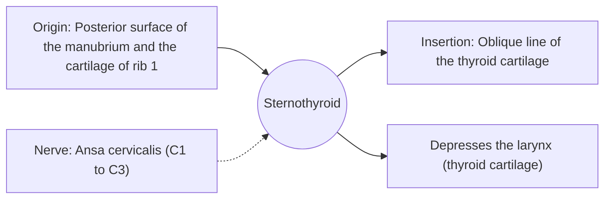

# Sternothyroid

## Summary

The sternothyroid is a flat, elongated quadrilateral infrahyoid muscle beneath the sternohyoid. It pulls the thyroid cartilage, and with it the larynx, down.

## Prerequisites

- [Muscular system overview](../muscular-system-overview.md)
- [Neck](../../regions/neck.md)

## Core concepts

### Definition

The *sternothyroid* is a strap muscle deeper and wider than the sternohyoid, running from the back of the manubrium to the thyroid cartilage.

### Analogy

The sternothyroid is like a downward tether on the larynx. It lowers the voice box after it has been raised in swallowing or singing high notes. The analogy breaks because the tether also helps fine-tune pitch with other laryngeal muscles.

### Mechanism

It continues upward as the thyrohyoid, which starts on the same oblique line. Together they control the vertical position of the larynx.

The diagram shows the attachments, the nerve and the actions.

### Attachments and innervation

| Feature | Description |
| --- | --- |
| Latin name | *musculus sternothyroideus* |
| Origin | Posterior surface of the manubrium and the cartilage of rib 1 |
| Insertion | Oblique line of the thyroid cartilage |
| Innervation | Ansa cervicalis (C1 to C3) |
| Actions | Depresses the larynx (thyroid cartilage) |

## Worked example

Singers lower the larynx for a darker tone, partly by the infrahyoid muscles including the sternothyroid. Laryngoscopy shows the larynx moving down as the muscle contracts.

## Trade offs and when to use it

Fine control of laryngeal position for voice and swallowing.

## Common mistakes

- **Saying it attaches to the hyoid.** It attaches to the thyroid cartilage.

## Practice

1. Where does the sternothyroid insert?
2. Which muscle continues upward from the same line?

### Answers

1. On the oblique line of the thyroid cartilage.
2. The thyrohyoid.

## Further reading

- Standring, S. (Ed.) (2020). *Gray's Anatomy: The Anatomical Basis of Clinical Practice (42nd ed.)*. Elsevier. Reference text for attachments, innervation and relations.
- Betts, J. G., Young, K. A., Wise, J. A. et al. (2022). *Anatomy and Physiology 2e*. OpenStax, Rice University. [Link](https://openstax.org/details/books/anatomy-and-physiology-2e). Open textbook with illustrations of the skeletal and muscular systems.
