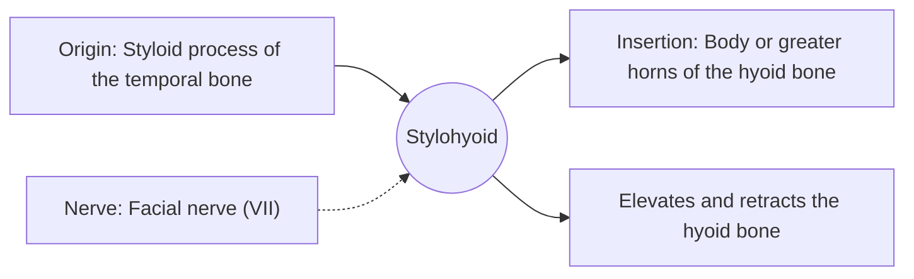

# Stylohyoid

## Summary

The stylohyoid is a thin suprahyoid muscle running from the styloid process of the temporal bone to the hyoid bone. It pulls the hyoid up and back, which lengthens the floor of the mouth during swallowing.

## Prerequisites

- [Muscular system overview](../muscular-system-overview.md)
- [Neck](../../regions/neck.md)

## Core concepts

### Definition

The *stylohyoid* is a slender muscle running alongside the posterior belly of the digastric. Near its insertion it usually splits around the digastric tendon.

### Analogy

The stylohyoid is like a cable pulling a crane hook (the hyoid) up and back toward a fixed post behind it (the styloid process). The analogy breaks because the cable splits around another cable (the digastric tendon) before attaching.

### Mechanism

It acts at the start of swallowing, drawing the hyoid back and up, which elongates the floor of the mouth and helps move food backward.

The diagram shows the attachments, the nerve and the actions.

### Attachments and innervation

| Feature | Description |
| --- | --- |
| Latin name | *musculus stylohyoideus* |
| Origin | Styloid process of the temporal bone |
| Insertion | Body or greater horns of the hyoid bone |
| Innervation | Facial nerve (VII) |
| Actions | Elevates and retracts the hyoid bone |

## Worked example

An elongated styloid process or calcified stylohyoid ligament (Eagle syndrome) can cause throat pain when swallowing or turning the head, illustrating how this region is tightly packed.

## Trade offs and when to use it

A small muscle with a narrow but timing-critical role in swallowing.

## Common mistakes

- **Confusing the stylohyoid muscle with the stylohyoid ligament.** The ligament connects the styloid process to the lesser horn; the muscle inserts on the body or greater horn.

## Practice

1. Which nerve supplies the stylohyoid?
2. In which direction does it pull the hyoid?

### Answers

1. The facial nerve.
2. Up and back.

## Further reading

- Standring, S. (Ed.) (2020). *Gray's Anatomy: The Anatomical Basis of Clinical Practice (42nd ed.)*. Elsevier. Reference text for attachments, innervation and relations.
- Betts, J. G., Young, K. A., Wise, J. A. et al. (2022). *Anatomy and Physiology 2e*. OpenStax, Rice University. [Link](https://openstax.org/details/books/anatomy-and-physiology-2e). Open textbook with illustrations of the skeletal and muscular systems.
