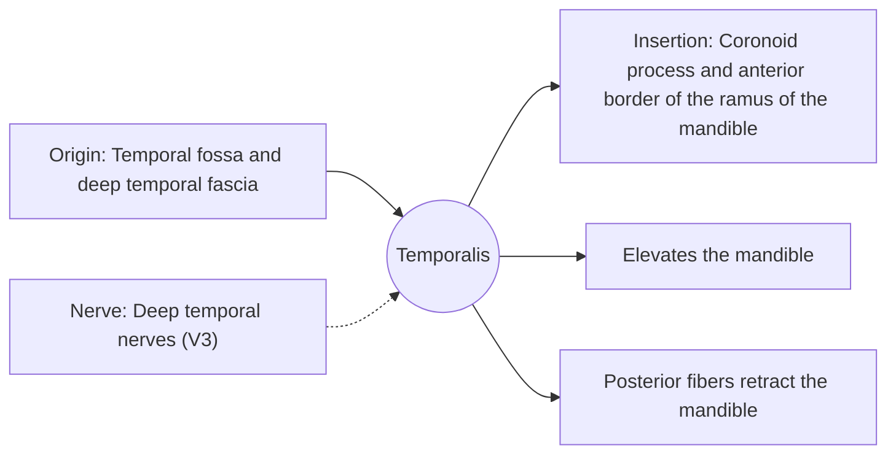

# Temporalis

## Summary

The temporalis is a fan-shaped chewing muscle on the side of the head above the ear. It closes the jaw and pulls it back. Tension in it is a common cause of headaches at the temples.

## Prerequisites

- [Muscular system overview](../muscular-system-overview.md)

## Core concepts

### Definition

The *temporalis* is a muscle of mastication filling the temporal fossa, converging into a tendon that passes under the zygomatic arch to the coronoid process of the mandible.

### Analogy

The temporalis is like a fan of ropes gathered into one cable: front fibers pull up, back fibers pull backward, so the same muscle can both close and retract the jaw. The analogy breaks because the fibers are activated selectively depending on the task.

### Mechanism

Anterior fibers run vertically and close the jaw; posterior fibers run almost horizontally and pull the mandible back after protrusion. It is active in positioning the jaw at rest.

The diagram shows the attachments, the nerve and the actions.

### Attachments and innervation

| Feature | Description |
| --- | --- |
| Latin name | *musculus temporalis* |
| Origin | Temporal fossa and deep temporal fascia |
| Insertion | Coronoid process and anterior border of the ramus of the mandible |
| Innervation | Deep temporal nerves (V3) |
| Actions | Elevates the mandible; Posterior fibers retract the mandible |

## Worked example

Placing the fingertips on the temples and clenching the teeth lets one feel the temporalis contract. Tension-type headaches are often felt here, and the muscle can be tender to touch in people who clench.

## Trade offs and when to use it

Large fan-shaped attachment allows fine control of jaw position but spreads tension over a wide area of the head.

## Common mistakes

- **Assuming temple pain always comes from the temporal bone.** Often it is muscular.

## Practice

1. Where does the temporalis insert?
2. Which fibers retract the jaw?

### Answers

1. On the coronoid process of the mandible.
2. The posterior fibers.

## Further reading

- Standring, S. (Ed.) (2020). *Gray's Anatomy: The Anatomical Basis of Clinical Practice (42nd ed.)*. Elsevier. Reference text for attachments, innervation and relations.
- Betts, J. G., Young, K. A., Wise, J. A. et al. (2022). *Anatomy and Physiology 2e*. OpenStax, Rice University. [Link](https://openstax.org/details/books/anatomy-and-physiology-2e). Open textbook with illustrations of the skeletal and muscular systems.
