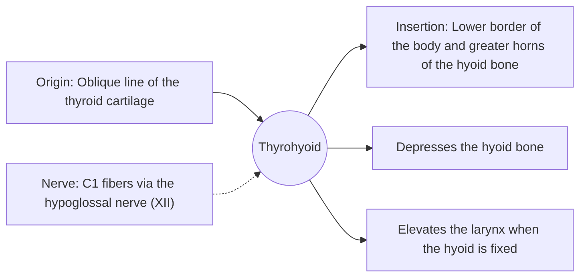

# Thyrohyoid

## Summary

The thyrohyoid is a short infrahyoid muscle that runs as a continuation of the sternothyroid from the thyroid cartilage to the hyoid bone. It lowers the hyoid or, when the hyoid is fixed, lifts the larynx.

## Prerequisites

- [Muscular system overview](../muscular-system-overview.md)
- [Neck](../../regions/neck.md)

## Core concepts

### Definition

The *thyrohyoid* is a small quadrilateral strap muscle connecting the thyroid cartilage to the hyoid bone. Unlike the other infrahyoid muscles, it is supplied by C1 fibers traveling with the hypoglossal nerve.

### Analogy

The thyrohyoid is like a short adjustable strap between two rings (hyoid and larynx). Shortening it brings the rings closer, either pulling the hyoid down or lifting the larynx up, depending on which ring is held. The analogy breaks because the "rings" are themselves moved by many other muscles.

### Mechanism

During swallowing, when the suprahyoid muscles have fixed the hyoid high, the thyrohyoid lifts the larynx toward it, which helps tuck the epiglottis over the airway.

The diagram shows the attachments, the nerve and the actions.

### Attachments and innervation

| Feature | Description |
| --- | --- |
| Latin name | *musculus thyrohyoideus* |
| Origin | Oblique line of the thyroid cartilage |
| Insertion | Lower border of the body and greater horns of the hyoid bone |
| Innervation | C1 fibers via the hypoglossal nerve (XII) |
| Actions | Depresses the hyoid bone; Elevates the larynx when the hyoid is fixed |

## Worked example

Placing a finger on the "Adam's apple" while swallowing lets one feel the larynx rise toward the hyoid. The thyrohyoid contributes to this movement.

## Trade offs and when to use it

A small muscle whose function depends on which end is fixed.

## Common mistakes

- **Assuming all infrahyoid muscles are supplied by the ansa cervicalis.** The thyrohyoid receives C1 fibers via the hypoglossal nerve.

## Practice

1. What does the thyrohyoid do when the hyoid is fixed?
2. Which nerve carries the fibers to the thyrohyoid?

### Answers

1. It lifts the larynx.
2. C1 fibers running with the hypoglossal nerve.

## Further reading

- Standring, S. (Ed.) (2020). *Gray's Anatomy: The Anatomical Basis of Clinical Practice (42nd ed.)*. Elsevier. Reference text for attachments, innervation and relations.
- Betts, J. G., Young, K. A., Wise, J. A. et al. (2022). *Anatomy and Physiology 2e*. OpenStax, Rice University. [Link](https://openstax.org/details/books/anatomy-and-physiology-2e). Open textbook with illustrations of the skeletal and muscular systems.
