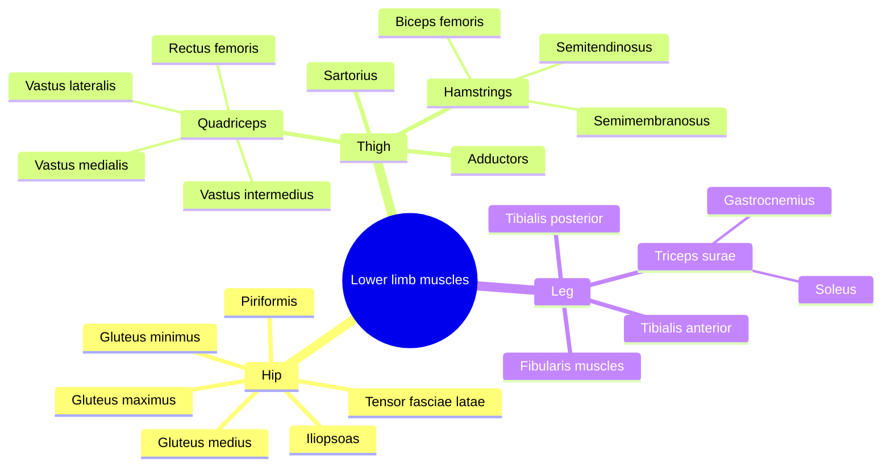

# Lower limb muscles

The lower limb muscles carry and move the body: they extend the hip and knee to stand, climb and jump, stabilize the pelvis on one leg, and push off with the foot. They are grouped here by region.

## Map

## Reading order

Hip:

1. [Gluteus maximus](gluteus-maximus.md)
2. [Gluteus medius](gluteus-medius.md)
3. [Gluteus minimus](gluteus-minimus.md)
4. [Piriformis](piriformis.md)
5. [Iliopsoas](iliopsoas.md)
6. [Tensor fasciae latae](tensor-fasciae-latae.md)

Thigh:

7. [Quadriceps femoris](quadriceps-femoris.md), then [Rectus femoris](rectus-femoris.md), [Vastus lateralis](vastus-lateralis.md), [Vastus medialis](vastus-medialis.md) and [Vastus intermedius](vastus-intermedius.md)
8. [Hamstrings](hamstrings.md), then [Biceps femoris](biceps-femoris.md), [Semitendinosus](semitendinosus.md) and [Semimembranosus](semimembranosus.md)
9. [Hip adductor muscles](adductors.md)
10. [Sartorius](sartorius.md)

Leg:

11. [Triceps surae](triceps-surae.md), then [Gastrocnemius](gastrocnemius.md) and [Soleus](soleus.md)
12. [Tibialis anterior](tibialis-anterior.md)
13. [Tibialis posterior](tibialis-posterior.md)
14. [Fibularis muscles](fibularis-muscles.md)

Training of the gluteal muscles by body shape is covered in [Glute training by shape](../../../exercise-and-fitness/training-types/glute-training-by-shape.md).
