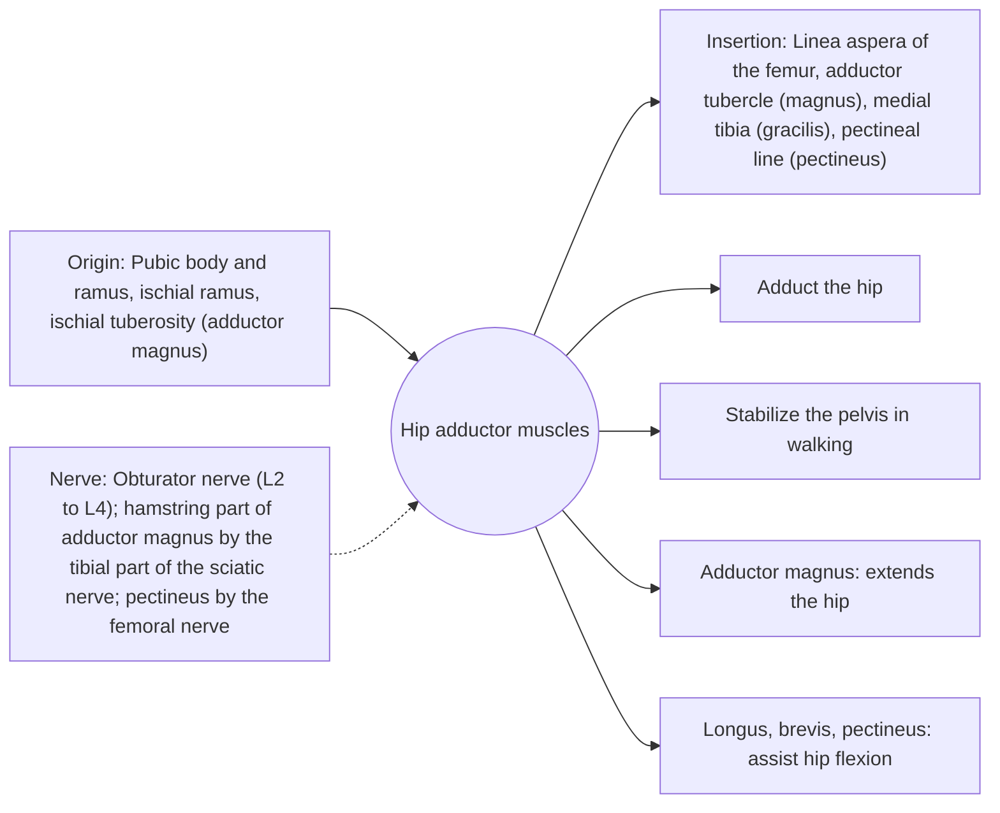

# Hip adductor muscles

## Summary

The hip adductors are a group of muscles on the inner thigh: adductor magnus, adductor longus, adductor brevis, gracilis and pectineus. They pull the thigh toward the midline, stabilize the pelvis in walking and contribute to hip flexion or extension depending on the hip angle. The adductor magnus is also a strong hip extensor.

## Prerequisites

- [Muscular system overview](../muscular-system-overview.md)

## Core concepts

### Definition

The *medial (adductor) compartment* of the thigh contains these muscles, mostly arising from the pubis and ischium and inserting along the femur.

### Analogy

The adductors are like a fan of ropes from the front of the pelvis to the inside of the thigh. Pulling them brings the legs together, as in squeezing a ball between the knees. The analogy breaks because the back part of the adductor magnus runs like a hamstring and straightens the hip.

### Mechanism

In a deep squat, the adductor magnus is a major hip extensor, contributing as much as the gluteus maximus in some studies. In sports with cutting and kicking, the adductor longus is often strained.

The diagram shows the attachments, the nerve and the actions.

### Attachments and innervation

| Feature | Description |
| --- | --- |
| Latin name | *musculi adductores* |
| Origin | Pubic body and ramus, ischial ramus, ischial tuberosity (adductor magnus) |
| Insertion | Linea aspera of the femur, adductor tubercle (magnus), medial tibia (gracilis), pectineal line (pectineus) |
| Innervation | Obturator nerve (L2 to L4); hamstring part of adductor magnus by the tibial part of the sciatic nerve; pectineus by the femoral nerve |
| Actions | Adduct the hip; Stabilize the pelvis in walking; Adductor magnus: extends the hip; Longus, brevis, pectineus: assist hip flexion |

### Muscles

| Muscle | Origin | Insertion | Note |
| --- | --- | --- | --- |
| Adductor magnus | Ischiopubic ramus, ischial tuberosity | Linea aspera, adductor tubercle | Largest; hamstring part extends the hip |
| Adductor longus | Pubic body | Middle linea aspera | Most often strained |
| Adductor brevis | Pubic body and inferior ramus | Upper linea aspera | Deep to longus |
| Gracilis | Pubic body and ramus | Medial tibia (pes anserinus) | Crosses the knee |
| Pectineus | Pectineal line of pubis | Pectineal line of femur | Also flexes the hip |

### Exercises and tests

Copenhagen adductor planks, sumo squats, cable adduction, side lunges.

## Worked example

The Copenhagen adductor exercise, a side plank with the top leg supported on a bench, reduced groin problems by about 40 percent in a 2019 randomized trial in amateur soccer players (Harøy and colleagues).

## Trade offs and when to use it

Important for stability and change of direction; often neglected in training.

## Common mistakes

- **Thinking adductors only squeeze the legs together.** The adductor magnus is a major hip extensor in squats.

## Practice

1. Which nerve supplies most adductors?
2. Which adductor is a strong hip extensor?
3. Which adductor exercise reduced groin problems in soccer?

### Answers

1. The obturator nerve.
2. The adductor magnus.
3. The Copenhagen adductor exercise.

## Further reading

- Standring, S. (Ed.) (2020). *Gray's Anatomy: The Anatomical Basis of Clinical Practice (42nd ed.)*. Elsevier. Reference text for attachments, innervation and relations.
- Betts, J. G., Young, K. A., Wise, J. A. et al. (2022). *Anatomy and Physiology 2e*. OpenStax, Rice University. [Link](https://openstax.org/details/books/anatomy-and-physiology-2e). Open textbook with illustrations of the skeletal and muscular systems.
- Harøy, J., Clarsen, B., Wiger, E. G. et al. (2019). The Adductor Strengthening Programme prevents groin problems among male football players: a cluster-randomised controlled trial. British Journal of Sports Medicine, 53(3), 150-157. [DOI](https://doi.org/10.1136/bjsports-2017-098937). Trial of the Copenhagen adductor programme in soccer.
