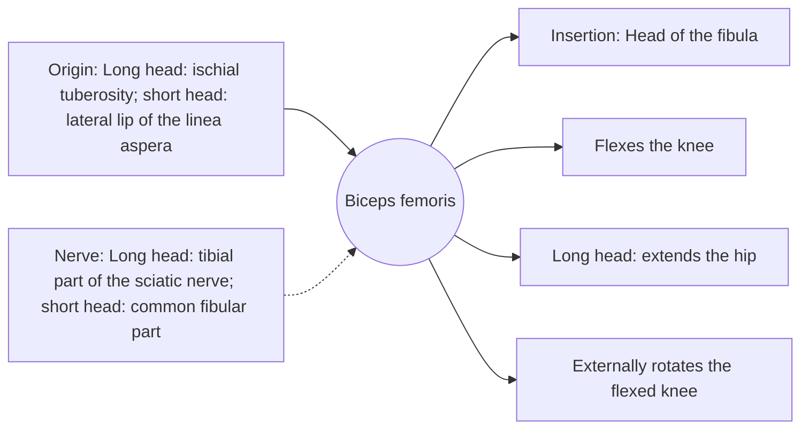

# Biceps femoris

## Summary

The biceps femoris is the lateral hamstring with two heads: a long head crossing the hip and knee and a short head crossing only the knee. It flexes the knee, extends the hip and rotates the bent knee outward. Its long head is the hamstring most often strained in sprinters.

## Prerequisites

- [Muscular system overview](../muscular-system-overview.md)

## Core concepts

### Definition

The *biceps femoris* forms the lateral border of the back of the knee (popliteal fossa) and inserts on the head of the fibula.

### Analogy

The two heads are like two ropes from different anchors pulling on the same ring at the fibula. The analogy breaks because they have different nerves, being from different parts of the sciatic nerve.

### Mechanism

Its long head is stretched most during the late swing phase of sprinting, which explains its high strain rate.

The diagram shows the attachments, the nerve and the actions.

### Attachments and innervation

| Feature | Description |
| --- | --- |
| Latin name | *musculus biceps femoris* |
| Origin | Long head: ischial tuberosity; short head: lateral lip of the linea aspera |
| Insertion | Head of the fibula |
| Innervation | Long head: tibial part of the sciatic nerve; short head: common fibular part |
| Actions | Flexes the knee; Long head: extends the hip; Externally rotates the flexed knee |

### Exercises and tests

Leg curls with the toes turned out, Romanian deadlifts, Nordic curls.

## Worked example

MRI studies of sprinters show that about 80 percent of hamstring strains involve the long head of the biceps femoris, often near the junction of muscle and tendon.

## Trade offs and when to use it

Strong lateral knee flexor and rotator, most vulnerable in sprinting.

## Common mistakes

- **Ignoring the short head.** Knee-dominant exercises such as leg curls train it.

## Practice

1. Where does the biceps femoris insert?
2. Which head is most often strained?

### Answers

1. On the head of the fibula.
2. The long head.

## Further reading

- Standring, S. (Ed.) (2020). *Gray's Anatomy: The Anatomical Basis of Clinical Practice (42nd ed.)*. Elsevier. Reference text for attachments, innervation and relations.
- Betts, J. G., Young, K. A., Wise, J. A. et al. (2022). *Anatomy and Physiology 2e*. OpenStax, Rice University. [Link](https://openstax.org/details/books/anatomy-and-physiology-2e). Open textbook with illustrations of the skeletal and muscular systems.
