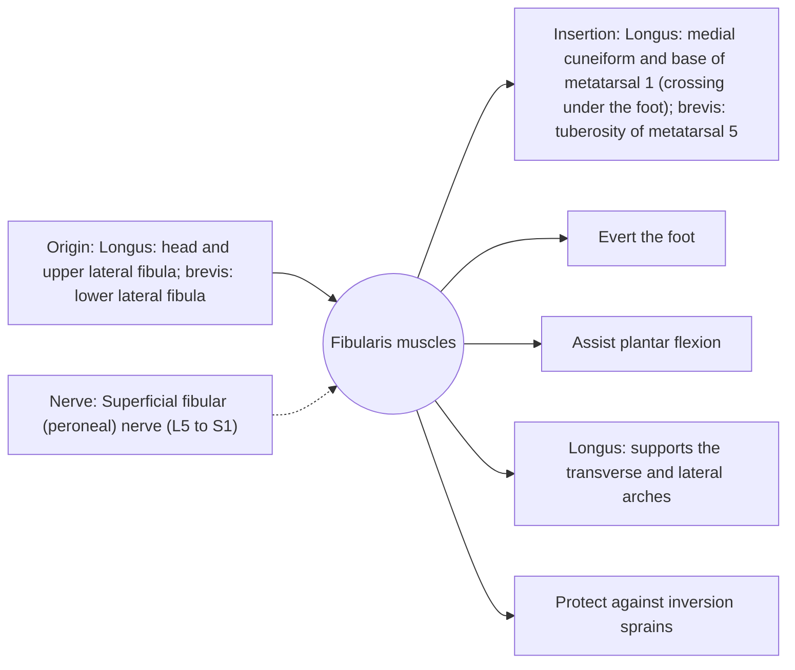

# Fibularis muscles

## Summary

The fibularis (peroneal) muscles, longus and brevis, run along the outer side of the lower leg, behind the outer ankle bone and into the foot. They evert the foot (turn the sole outward), assist plantar flexion and protect the ankle from inversion sprains. The fibularis longus also crosses under the foot and supports the arches.

## Prerequisites

- [Muscular system overview](../muscular-system-overview.md)

## Core concepts

### Definition

The *fibularis longus* and *fibularis brevis* form the lateral compartment of the leg. A third muscle, the fibularis tertius, belongs to the anterior compartment. Fibularis brevis is often listed as a unipennate muscle.

### Analogy

The fibularis muscles are like the guardrails on the outside of a mountain road: when the foot starts to roll outward over its edge (inversion), they pull it back. The analogy breaks because they need to react within tens of milliseconds, which is trained with balance exercises.

### Mechanism

The longus tendon runs under the foot in a groove of the cuboid, forming a stirrup with the tibialis anterior that supports the arch.

The diagram shows the attachments, the nerve and the actions.

### Attachments and innervation

| Feature | Description |
| --- | --- |
| Latin name | *musculi fibulares* |
| Origin | Longus: head and upper lateral fibula; brevis: lower lateral fibula |
| Insertion | Longus: medial cuneiform and base of metatarsal 1 (crossing under the foot); brevis: tuberosity of metatarsal 5 |
| Innervation | Superficial fibular (peroneal) nerve (L5 to S1) |
| Actions | Evert the foot; Assist plantar flexion; Longus: supports the transverse and lateral arches; Protect against inversion sprains |

### Exercises and tests

Resisted eversion with a band, single-leg balance on unstable surfaces, lateral hops.

## Worked example

After an ankle sprain, the reaction time of the fibularis muscles is often slowed. Balance training on one leg for several weeks after the sprain reduced the risk of repeat sprains by about a third in trials.

## Trade offs and when to use it

Fast-reacting protectors of the ankle; injury to their tendons behind the lateral malleolus can be missed after sprains.

## Common mistakes

- **Calling them peroneal and fibular as different muscles.** Peroneal is the older name; fibular is the current term.

## Practice

1. Which nerve supplies the fibularis muscles?
2. Where does the fibularis brevis insert?
3. What exercise reduces repeat ankle sprains?

### Answers

1. The superficial fibular nerve.
2. On the tuberosity of the fifth metatarsal.
3. Single-leg balance training.

## Further reading

- Standring, S. (Ed.) (2020). *Gray's Anatomy: The Anatomical Basis of Clinical Practice (42nd ed.)*. Elsevier. Reference text for attachments, innervation and relations.
- Betts, J. G., Young, K. A., Wise, J. A. et al. (2022). *Anatomy and Physiology 2e*. OpenStax, Rice University. [Link](https://openstax.org/details/books/anatomy-and-physiology-2e). Open textbook with illustrations of the skeletal and muscular systems.
