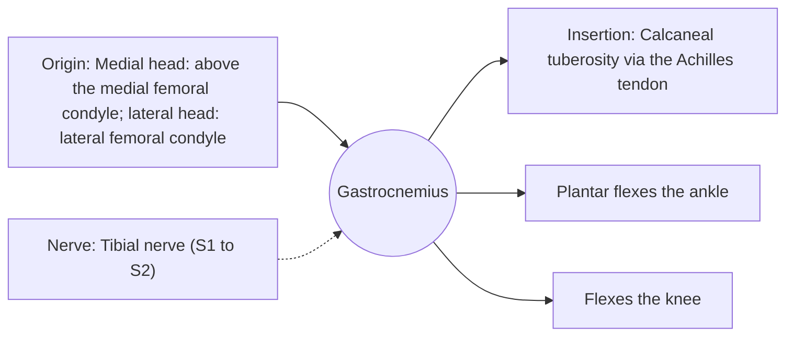

# Gastrocnemius

## Summary

The gastrocnemius is the superficial, two-headed calf muscle that forms the visible bulge at the back of the lower leg. It plantar flexes the ankle and flexes the knee. It contains many fast-twitch fibers and works in jumping and sprinting.

## Prerequisites

- [Muscular system overview](../muscular-system-overview.md)

## Core concepts

### Definition

The *gastrocnemius* has medial and lateral heads arising above the knee, joining into the Achilles tendon.

### Analogy

The gastrocnemius is like a rope over two pulleys: it points the foot and bends the knee. When the knee is bent, the rope is slack and pulls less on the ankle. The analogy breaks because the medial head is larger and works more than the lateral head.

### Mechanism

Being a two-joint muscle, it is strongest at the ankle when the knee is straight. A "tennis leg" injury is a tear of the medial head.

The diagram shows the attachments, the nerve and the actions.

### Attachments and innervation

| Feature | Description |
| --- | --- |
| Latin name | *musculus gastrocnemius* |
| Origin | Medial head: above the medial femoral condyle; lateral head: lateral femoral condyle |
| Insertion | Calcaneal tuberosity via the Achilles tendon |
| Innervation | Tibial nerve (S1 to S2) |
| Actions | Plantar flexes the ankle; Flexes the knee |

### Exercises and tests

Standing calf raises, jumping, sprinting.

## Worked example

"Tennis leg" is a sudden tear of the medial gastrocnemius during a lunge forward, felt as a kick in the calf. It usually heals without surgery with early mobilization over several weeks.

## Trade offs and when to use it

Fast and forceful, but its two-joint arrangement limits its role when the knee is flexed.

## Common mistakes

- **Testing calf strength only seated.** Seated tests mainly measure the soleus.

## Practice

1. Why is the gastrocnemius weaker at the ankle when the knee is bent?
2. Which head is torn in tennis leg?

### Answers

1. It crosses the knee, so knee flexion shortens it and reduces its tension at the ankle.
2. The medial head.

## Further reading

- Standring, S. (Ed.) (2020). *Gray's Anatomy: The Anatomical Basis of Clinical Practice (42nd ed.)*. Elsevier. Reference text for attachments, innervation and relations.
- Betts, J. G., Young, K. A., Wise, J. A. et al. (2022). *Anatomy and Physiology 2e*. OpenStax, Rice University. [Link](https://openstax.org/details/books/anatomy-and-physiology-2e). Open textbook with illustrations of the skeletal and muscular systems.
