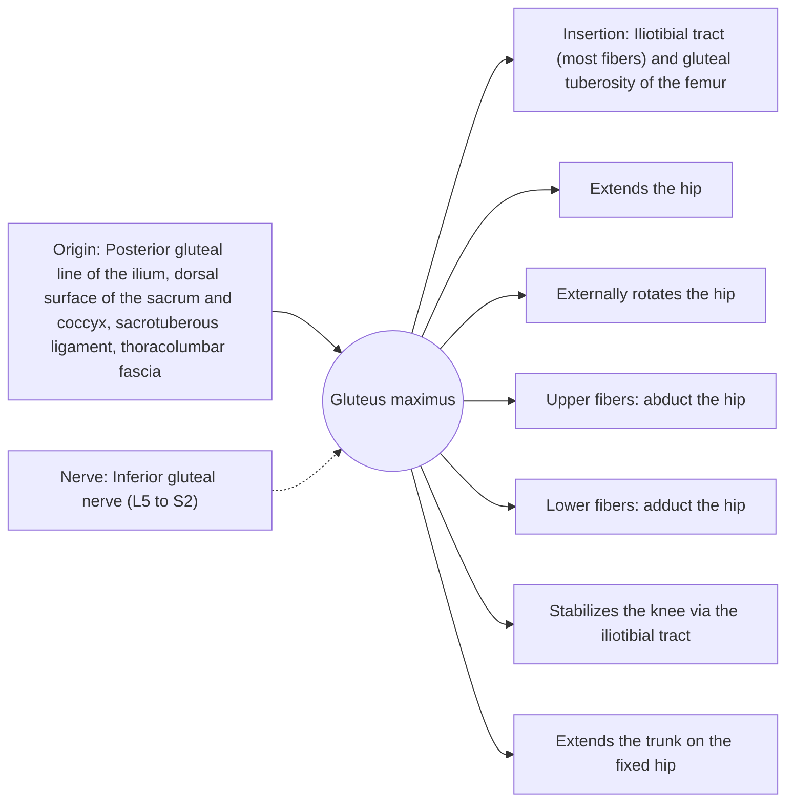

# Gluteus maximus

## Summary

The gluteus maximus is the largest and most superficial buttock muscle and one of the strongest muscles of the body. It extends and externally rotates the hip, and its upper fibers abduct it. It works hardest when climbing, running, jumping and rising from a squat, and it shapes the buttocks.

## Prerequisites

- [Muscular system overview](../muscular-system-overview.md)

## Core concepts

### Definition

The *gluteus maximus* is a thick, quadrilateral muscle covering most of the buttock, with coarse fascicles running down and outward.

### Analogy

The gluteus maximus is like the main engine that straightens the hinge between the trunk and the thigh. In walking on level ground it idles; on stairs and hills it does the heavy work. The analogy breaks because part of the muscle also tensions a long strap down the outside of the thigh (the iliotibial tract) that stabilizes the knee.

### Mechanism

It is most active at large hip flexion angles and against heavy load. Its connection to the thoracolumbar fascia couples it with the opposite latissimus dorsi. In hip thrusts it is most active near full hip extension; in squats and lunges it works harder at deep hip flexion.

The diagram shows the attachments, the nerve and the actions.

### Attachments and innervation

| Feature | Description |
| --- | --- |
| Latin name | *musculus gluteus maximus* |
| Origin | Posterior gluteal line of the ilium, dorsal surface of the sacrum and coccyx, sacrotuberous ligament, thoracolumbar fascia |
| Insertion | Iliotibial tract (most fibers) and gluteal tuberosity of the femur |
| Innervation | Inferior gluteal nerve (L5 to S2) |
| Actions | Extends the hip; Externally rotates the hip; Upper fibers: abduct the hip; Lower fibers: adduct the hip; Stabilizes the knee via the iliotibial tract; Extends the trunk on the fixed hip |

### Exercises and tests

Hip thrusts, glute bridges, squats, lunges, deadlifts, step-ups, back extensions.

## Worked example

Electromyography studies comparing exercises often find high gluteus maximus activity in hip thrusts and step-ups. A 2020 trial (Barbalho and colleagues) found similar gluteal growth with squats and hip thrusts over 12 weeks, so both are useful choices.

## Trade offs and when to use it

The strongest hip extensor; its development depends on training at both long and short muscle lengths.

## Common mistakes

- **Thinking walking trains the gluteus maximus well.** It is only lightly active on level ground; climbing and loaded hip extension challenge it.

## Practice

1. Which nerve supplies the gluteus maximus?
2. Where do most of its fibers insert?

### Answers

1. The inferior gluteal nerve.
2. Into the iliotibial tract.

## Further reading

- Standring, S. (Ed.) (2020). *Gray's Anatomy: The Anatomical Basis of Clinical Practice (42nd ed.)*. Elsevier. Reference text for attachments, innervation and relations.
- Betts, J. G., Young, K. A., Wise, J. A. et al. (2022). *Anatomy and Physiology 2e*. OpenStax, Rice University. [Link](https://openstax.org/details/books/anatomy-and-physiology-2e). Open textbook with illustrations of the skeletal and muscular systems.
- Barbalho, M., Coswig, V., Souza, D. et al. (2020). Back squat vs. hip thrust resistance-training programs in well-trained women. International Journal of Sports Medicine, 41(5), 306-310. [DOI](https://doi.org/10.1055/a-1082-1126). Trial comparing squats and hip thrusts for gluteal growth.
