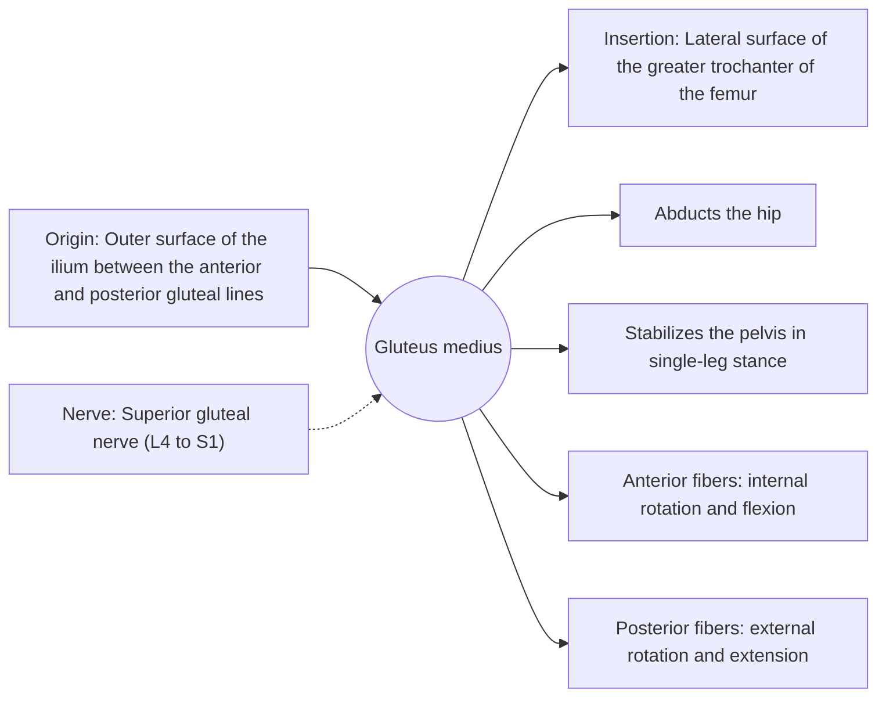

# Gluteus medius

## Summary

The gluteus medius is a fan-shaped muscle on the outer side of the pelvis, partly under the gluteus maximus. It abducts the hip and, most importantly, holds the pelvis level when standing on one leg, as in every step of walking. Its front fibers rotate the hip inward and its back fibers outward.

## Prerequisites

- [Muscular system overview](../muscular-system-overview.md)

## Core concepts

### Definition

The *gluteus medius* lies between the gluteus maximus and the gluteus minimus, with anterior, middle and posterior fibers.

### Analogy

The gluteus medius is like the guy rope on the side of a one-legged stand: when you stand on your right leg, the right gluteus medius pulls on the pelvis so it does not tip down on the left. The analogy breaks because the rope works in a split second, step after step.

### Mechanism

In single-leg stance, it must produce a force roughly equal to one to two times body weight to balance the pelvis, because its lever arm is shorter than that of body weight. Weakness shows as the Trendelenburg sign (see [Hip joint](../../joints/hip-joint.md)).

The diagram shows the attachments, the nerve and the actions.

### Attachments and innervation

| Feature | Description |
| --- | --- |
| Latin name | *musculus gluteus medius* |
| Origin | Outer surface of the ilium between the anterior and posterior gluteal lines |
| Insertion | Lateral surface of the greater trochanter of the femur |
| Innervation | Superior gluteal nerve (L4 to S1) |
| Actions | Abducts the hip; Stabilizes the pelvis in single-leg stance; Anterior fibers: internal rotation and flexion; Posterior fibers: external rotation and extension |

### Exercises and tests

Side-lying hip abduction, banded lateral walks, single-leg squats and deadlifts, side planks with leg lift.

## Worked example

Runners with weak hip abductors often let the knee drift inward and the pelvis drop on landing. This pattern is associated with patellofemoral pain and iliotibial band pain, and hip strengthening reduces pain in trials of patellofemoral pain.

## Trade offs and when to use it

Essential for walking and running; often undertrained by programs focused on the sagittal plane.

## Common mistakes

- **Relying only on squats for hip stability.** Add single-leg and frontal-plane work.

## Practice

1. Which nerve supplies the gluteus medius?
2. What is its main role in walking?

### Answers

1. The superior gluteal nerve.
2. Holding the pelvis level during single-leg stance.

## Further reading

- Standring, S. (Ed.) (2020). *Gray's Anatomy: The Anatomical Basis of Clinical Practice (42nd ed.)*. Elsevier. Reference text for attachments, innervation and relations.
- Betts, J. G., Young, K. A., Wise, J. A. et al. (2022). *Anatomy and Physiology 2e*. OpenStax, Rice University. [Link](https://openstax.org/details/books/anatomy-and-physiology-2e). Open textbook with illustrations of the skeletal and muscular systems.
