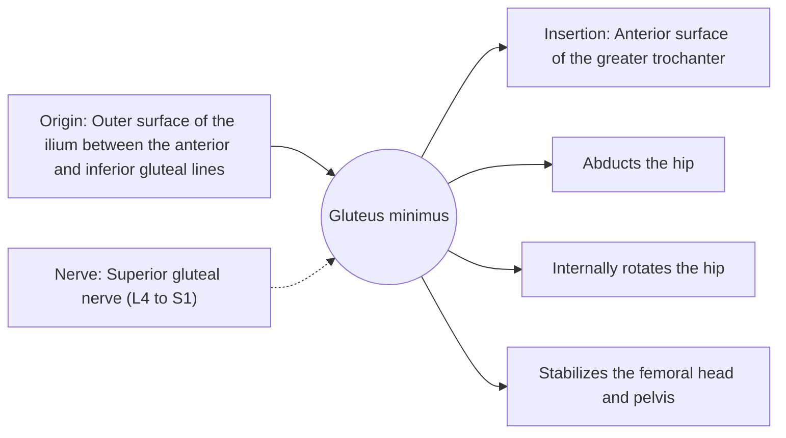

# Gluteus minimus

## Summary

The gluteus minimus is the smallest and deepest gluteal muscle, lying under the gluteus medius. It abducts the hip, rotates it inward and helps stabilize the head of the femur in its socket and the pelvis in single-leg stance.

## Prerequisites

- [Muscular system overview](../muscular-system-overview.md)

## Core concepts

### Definition

The *gluteus minimus* is a small triangular muscle on the outer surface of the ilium, beneath the gluteus medius.

### Analogy

The gluteus minimus is like a smaller deputy of the gluteus medius, working from underneath and pressing the femoral head into the socket. The analogy breaks because its front fibers mainly rotate the hip inward, a separate job.

### Mechanism

With the gluteus medius, it forms the main hip abductors. Tendinopathy of both is a common cause of pain on the outer hip, especially in women over 40.

The diagram shows the attachments, the nerve and the actions.

### Attachments and innervation

| Feature | Description |
| --- | --- |
| Latin name | *musculus gluteus minimus* |
| Origin | Outer surface of the ilium between the anterior and inferior gluteal lines |
| Insertion | Anterior surface of the greater trochanter |
| Innervation | Superior gluteal nerve (L4 to S1) |
| Actions | Abducts the hip; Internally rotates the hip; Stabilizes the femoral head and pelvis |

### Exercises and tests

As for the gluteus medius; internal rotation work.

## Worked example

Greater trochanteric pain syndrome causes pain over the side of the hip, worse when lying on that side or crossing the legs. It usually involves gluteus medius and minimus tendinopathy rather than bursitis alone, and education plus progressive loading outperformed a single corticosteroid injection at one year in a 2018 trial (LEAP).

## Trade offs and when to use it

Small stabilizer whose tendon is vulnerable to compression when the leg is crossed.

## Common mistakes

- **Stretching painful outer hip tendons by crossing the leg.** Compression aggravates gluteal tendinopathy.

## Practice

1. Which nerve supplies the gluteus minimus?
2. Name two actions of the gluteus minimus.

### Answers

1. The superior gluteal nerve.
2. Hip abduction and internal rotation.

## Further reading

- Standring, S. (Ed.) (2020). *Gray's Anatomy: The Anatomical Basis of Clinical Practice (42nd ed.)*. Elsevier. Reference text for attachments, innervation and relations.
- Betts, J. G., Young, K. A., Wise, J. A. et al. (2022). *Anatomy and Physiology 2e*. OpenStax, Rice University. [Link](https://openstax.org/details/books/anatomy-and-physiology-2e). Open textbook with illustrations of the skeletal and muscular systems.
- Mellor, R., Bennell, K., Grimaldi, A. et al. (2018). Education plus exercise versus corticosteroid injection use versus a wait and see approach on global outcome and pain from gluteal tendinopathy: prospective, single blinded, randomised clinical trial. BMJ, 361, k1662. [DOI](https://doi.org/10.1136/bmj.k1662). LEAP trial on gluteal tendinopathy treatment.
