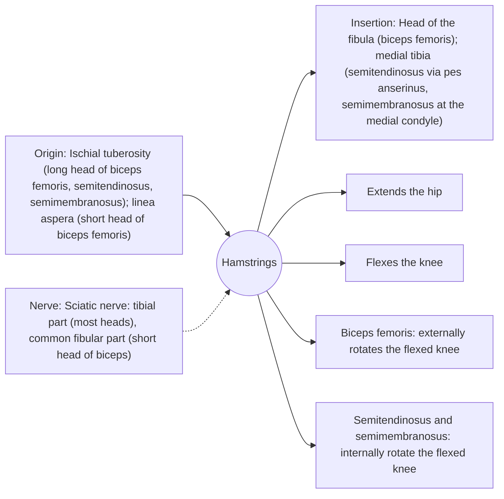

# Hamstrings

## Summary

The hamstrings are the three muscles at the back of the thigh: biceps femoris, semitendinosus and semimembranosus. All except the short head of the biceps cross both the hip and the knee, so they extend the hip and flex the knee. They are the most commonly strained muscles in sprinting sports.

## Prerequisites

- [Muscular system overview](../muscular-system-overview.md)

## Core concepts

### Definition

The *hamstring group* arises mostly from the ischial tuberosity and inserts below the knee on the tibia and fibula.

### Analogy

The hamstrings are like ropes across the back of two hinges: they can straighten the hip, bend the knee, or both. In sprinting they must brake the lower leg as it swings forward while the hip is flexed, which stretches them under high tension. The analogy breaks because the short head of the biceps only crosses the knee.

### Mechanism

They work eccentrically at the end of the swing phase in running to decelerate the leg. This is when most sprinting strains occur.

The diagram shows the attachments, the nerve and the actions.

### Attachments and innervation

| Feature | Description |
| --- | --- |
| Latin name | *musculi ischiocrurales* |
| Origin | Ischial tuberosity (long head of biceps femoris, semitendinosus, semimembranosus); linea aspera (short head of biceps femoris) |
| Insertion | Head of the fibula (biceps femoris); medial tibia (semitendinosus via pes anserinus, semimembranosus at the medial condyle) |
| Innervation | Sciatic nerve: tibial part (most heads), common fibular part (short head of biceps) |
| Actions | Extends the hip; Flexes the knee; Biceps femoris: externally rotates the flexed knee; Semitendinosus and semimembranosus: internally rotate the flexed knee |

### Muscles

| Muscle | Position | Note |
| --- | --- | --- |
| [Biceps femoris](biceps-femoris.md) | Lateral | Two heads; most often strained |
| [Semitendinosus](semitendinosus.md) | Medial, superficial | Long tendon used for ACL grafts |
| [Semimembranosus](semimembranosus.md) | Medial, deep | Broad flat tendon |

### Exercises and tests

Romanian deadlifts, Nordic hamstring curls, seated and lying leg curls, good mornings, hip thrusts (partly).

## Worked example

The Nordic hamstring exercise, a slow eccentric lowering of the trunk from kneeling with the ankles held, roughly halved hamstring injuries in soccer players in randomized trials and meta-analyses, when included in regular training.

## Trade offs and when to use it

Two-joint muscles that are trained best with both hip-dominant and knee-dominant exercises.

## Common mistakes

- **Training hamstrings only with leg curls.** Hip extension exercises train their hip function; Nordics train the eccentric strength that prevents strains.

## Practice

1. Which hamstring part does not cross the hip?
2. When in sprinting do most hamstring strains occur?
3. Which exercise reduces hamstring injuries in trials?

### Answers

1. The short head of the biceps femoris.
2. At the end of the swing phase, when the muscles brake the leg eccentrically.
3. The Nordic hamstring exercise.

## Further reading

- Standring, S. (Ed.) (2020). *Gray's Anatomy: The Anatomical Basis of Clinical Practice (42nd ed.)*. Elsevier. Reference text for attachments, innervation and relations.
- Betts, J. G., Young, K. A., Wise, J. A. et al. (2022). *Anatomy and Physiology 2e*. OpenStax, Rice University. [Link](https://openstax.org/details/books/anatomy-and-physiology-2e). Open textbook with illustrations of the skeletal and muscular systems.
- Petersen, J., Thorborg, K., Nielsen, M. B. et al. (2011). Preventive effect of eccentric training on acute hamstring injuries in men's soccer: a cluster-randomized controlled trial. American Journal of Sports Medicine, 39(11), 2296-2303. [DOI](https://doi.org/10.1177/0363546511419277). Trial of the Nordic hamstring exercise in soccer.
