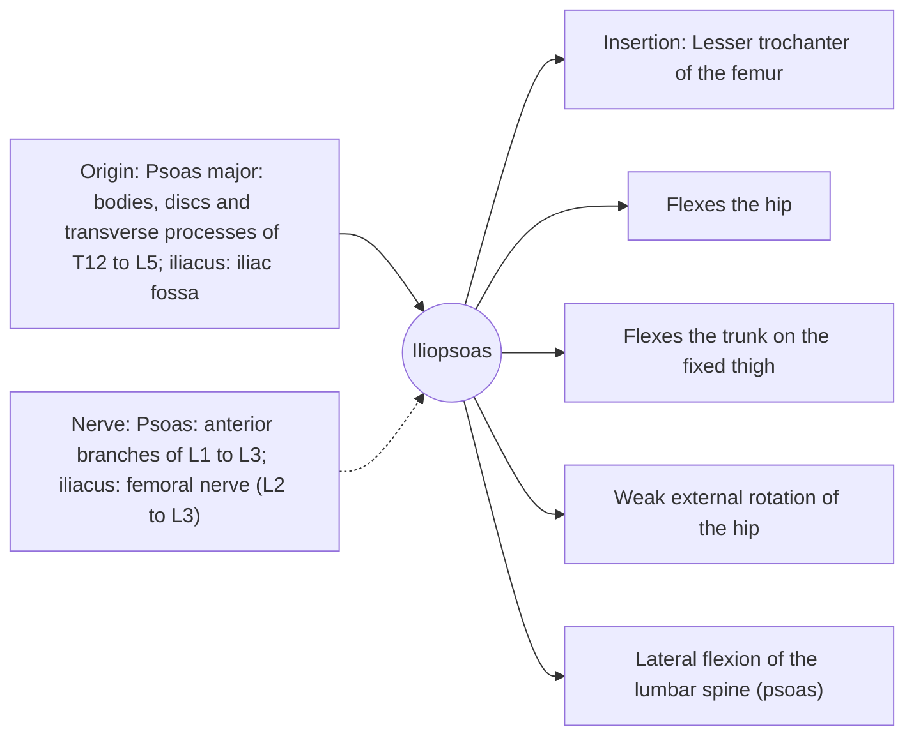

# Iliopsoas

## Summary

The iliopsoas is the strongest hip flexor, made of the psoas major, which comes from the lumbar spine, and the iliacus, which lines the inside of the pelvis. Both insert on the lesser trochanter of the femur. It lifts the thigh in walking, running and climbing and flexes the trunk on the thighs in sit-ups.

## Prerequisites

- [Muscular system overview](../muscular-system-overview.md)

## Core concepts

### Definition

The *iliopsoas* is a compound muscle of the *psoas major* (sometimes with a psoas minor) and the *iliacus*, joined in a common tendon.

### Analogy

The psoas is like a rope from the lower spine to the thigh passing over the front of the pelvis like over a pulley. Pulling it lifts the thigh, or, if the legs are fixed, pulls the trunk forward. The analogy breaks because the psoas also pulls on the lumbar vertebrae and can increase lumbar lordosis.

### Mechanism

In walking, it swings the leg forward. In a sit-up with straight legs, it does most of the work after the first part of the movement, pulling the lumbar spine forward.

The diagram shows the attachments, the nerve and the actions.

### Attachments and innervation

| Feature | Description |
| --- | --- |
| Latin name | *musculus iliopsoas* |
| Origin | Psoas major: bodies, discs and transverse processes of T12 to L5; iliacus: iliac fossa |
| Insertion | Lesser trochanter of the femur |
| Innervation | Psoas: anterior branches of L1 to L3; iliacus: femoral nerve (L2 to L3) |
| Actions | Flexes the hip; Flexes the trunk on the fixed thigh; Weak external rotation of the hip; Lateral flexion of the lumbar spine (psoas) |

### Exercises and tests

Hanging leg raises, knee raises, sprinting, step-ups; stretching in a half-kneeling lunge with the pelvis tucked.

## Worked example

Long sitting keeps the hip flexed. The common advice that a "tight psoas" causes back pain has limited evidence, but hip flexor stretching combined with glute strengthening is a common, low-risk approach for people who sit a lot and feel stiff in the front of the hip.

## Trade offs and when to use it

Strong and necessary for running speed; its lumbar attachment links hip flexion to spinal loading.

## Common mistakes

- **Doing many straight-leg sit-ups to train the abdominals.** Much of the work then shifts to the iliopsoas.

## Practice

1. Where does the iliopsoas insert?
2. Which two muscles form the iliopsoas?

### Answers

1. On the lesser trochanter of the femur.
2. The psoas major and the iliacus.

## Further reading

- Standring, S. (Ed.) (2020). *Gray's Anatomy: The Anatomical Basis of Clinical Practice (42nd ed.)*. Elsevier. Reference text for attachments, innervation and relations.
- Betts, J. G., Young, K. A., Wise, J. A. et al. (2022). *Anatomy and Physiology 2e*. OpenStax, Rice University. [Link](https://openstax.org/details/books/anatomy-and-physiology-2e). Open textbook with illustrations of the skeletal and muscular systems.
