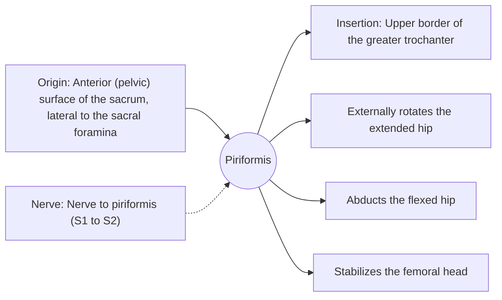

# Piriformis

## Summary

The piriformis is a pear-shaped deep hip muscle running from the front of the sacrum to the top of the greater trochanter. It rotates the extended hip outward and abducts the flexed hip. The sciatic nerve usually passes just below it, so tightness of the piriformis is one possible source of buttock pain spreading down the leg.

## Prerequisites

- [Muscular system overview](../muscular-system-overview.md)

## Core concepts

### Definition

The *piriformis* is the uppermost of the deep lateral rotators of the hip (with the gemelli, obturators and quadratus femoris). It leaves the pelvis through the greater sciatic foramen.

### Analogy

The piriformis is like a short cable that turns the femur outward like a key in a lock when the leg is straight. When the hip is bent past about 60 degrees, the same cable changes its line of pull and starts to rotate the hip inward and abduct it. The analogy breaks because few cables reverse their function with position.

### Mechanism

Its function depends on hip position: external rotation with the hip straight, abduction and internal rotation with the hip flexed. This makes it a typical example of a muscle whose role changes with joint angle.

The diagram shows the attachments, the nerve and the actions.

### Attachments and innervation

| Feature | Description |
| --- | --- |
| Latin name | *musculus piriformis* |
| Origin | Anterior (pelvic) surface of the sacrum, lateral to the sacral foramina |
| Insertion | Upper border of the greater trochanter |
| Innervation | Nerve to piriformis (S1 to S2) |
| Actions | Externally rotates the extended hip; Abducts the flexed hip; Stabilizes the femoral head |

### Exercises and tests

Clamshells, banded external rotation; stretching by pulling the bent knee toward the opposite shoulder.

## Worked example

"Piriformis syndrome" describes buttock pain with sciatica-like symptoms attributed to compression of the sciatic nerve by the piriformis. In about 10 to 20 percent of people, part of the sciatic nerve passes through the muscle. The diagnosis remains debated, and disc and nerve root problems must be ruled out first.

## Trade offs and when to use it

A deep stabilizer whose clinical role is often overestimated.

## Common mistakes

- **Attributing all buttock pain to the piriformis.** Lumbar disc problems, sacroiliac and hamstring tendon problems are more common causes.

## Practice

1. What does the piriformis do with the hip extended?
2. Which nerve passes below the piriformis?

### Answers

1. External rotation.
2. The sciatic nerve.

## Further reading

- Standring, S. (Ed.) (2020). *Gray's Anatomy: The Anatomical Basis of Clinical Practice (42nd ed.)*. Elsevier. Reference text for attachments, innervation and relations.
- Betts, J. G., Young, K. A., Wise, J. A. et al. (2022). *Anatomy and Physiology 2e*. OpenStax, Rice University. [Link](https://openstax.org/details/books/anatomy-and-physiology-2e). Open textbook with illustrations of the skeletal and muscular systems.
