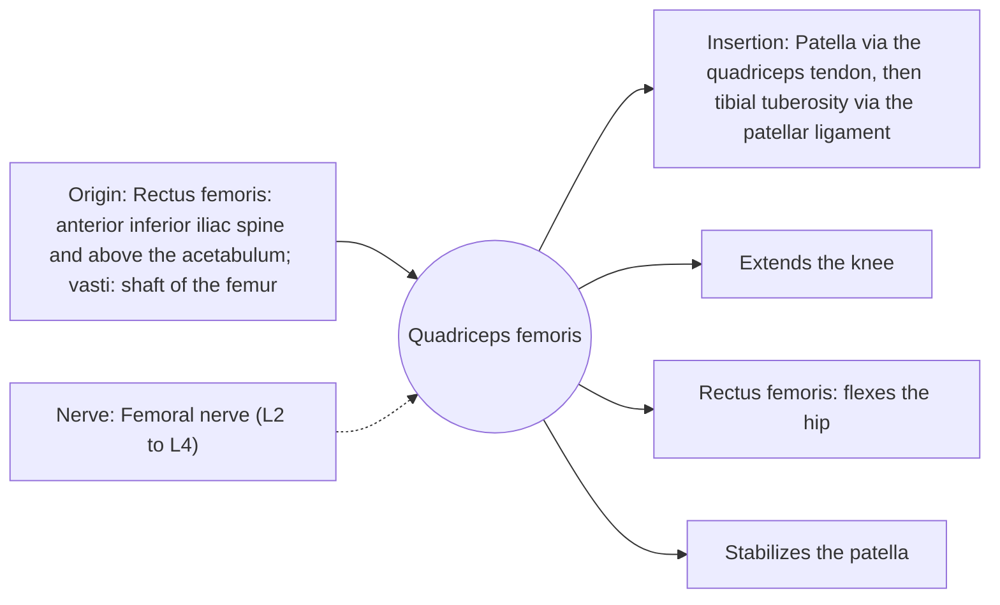

# Quadriceps femoris

## Summary

The quadriceps femoris is the large four-headed muscle on the front of the thigh and the main extensor of the knee. Its heads are the rectus femoris, vastus lateralis, vastus medialis and vastus intermedius. They join in the quadriceps tendon, which contains the patella and continues as the patellar ligament to the tibia. Only the rectus femoris also crosses the hip.

## Prerequisites

- [Muscular system overview](../muscular-system-overview.md)

## Core concepts

### Definition

The *quadriceps femoris* is a muscle group of four heads in the anterior compartment of the thigh, all supplied by the femoral nerve.

### Analogy

The quadriceps is like four ropes joined into one cable that runs over a pulley (the patella) to straighten a hinge (the knee). Three ropes start on the thigh bone and one starts higher, on the pelvis. The analogy breaks because the heads pull in slightly different directions, which steers the patella.

### Mechanism

The quadriceps works concentrically when standing up and eccentrically when sitting down, descending stairs or landing from a jump. In a squat, its demand rises with knee flexion and forward knee travel.

The diagram shows the attachments, the nerve and the actions.

### Attachments and innervation

| Feature | Description |
| --- | --- |
| Latin name | *musculus quadriceps femoris* |
| Origin | Rectus femoris: anterior inferior iliac spine and above the acetabulum; vasti: shaft of the femur |
| Insertion | Patella via the quadriceps tendon, then tibial tuberosity via the patellar ligament |
| Innervation | Femoral nerve (L2 to L4) |
| Actions | Extends the knee; Rectus femoris: flexes the hip; Stabilizes the patella |

### Heads

| Head | Origin | Note |
| --- | --- | --- |
| [Rectus femoris](rectus-femoris.md) | Anterior inferior iliac spine | Two-joint, also flexes the hip |
| [Vastus lateralis](vastus-lateralis.md) | Greater trochanter and lateral linea aspera | Largest head |
| [Vastus medialis](vastus-medialis.md) | Medial linea aspera | Teardrop shape above the knee |
| [Vastus intermedius](vastus-intermedius.md) | Front of the femoral shaft | Deep, under rectus femoris |

### Exercises and tests

Squats, lunges, leg presses, leg extensions, step-ups, split squats.

## Worked example

After knee surgery, the quadriceps loses strength and size quickly, partly because swelling inhibits it reflexively (arthrogenic muscle inhibition). Early quadriceps activation, electrical stimulation and progressive loading are central to rehabilitation.

## Trade offs and when to use it

Large and strong, essential for standing up and walking down stairs; weakness predicts functional decline in older adults.

## Common mistakes

- **Avoiding knee flexion past 90 degrees for knee health.** Deep squats are safe for healthy knees with gradual progression and load the quadriceps well.

## Practice

1. Name the four heads of the quadriceps.
2. Which head crosses the hip?
3. Which nerve supplies the quadriceps?

### Answers

1. Rectus femoris, vastus lateralis, vastus medialis, vastus intermedius.
2. The rectus femoris.
3. The femoral nerve.

## Further reading

- Standring, S. (Ed.) (2020). *Gray's Anatomy: The Anatomical Basis of Clinical Practice (42nd ed.)*. Elsevier. Reference text for attachments, innervation and relations.
- Betts, J. G., Young, K. A., Wise, J. A. et al. (2022). *Anatomy and Physiology 2e*. OpenStax, Rice University. [Link](https://openstax.org/details/books/anatomy-and-physiology-2e). Open textbook with illustrations of the skeletal and muscular systems.
