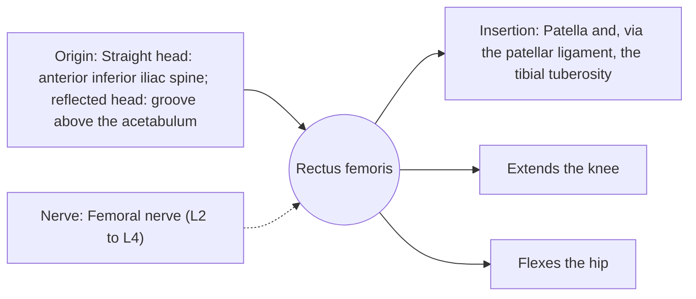

# Rectus femoris

## Summary

The rectus femoris is the only quadriceps head that crosses both the hip and the knee. It extends the knee and flexes the hip, and it is most active in kicking and sprinting. It is a classic example of a two-joint (biarticular) muscle.

## Prerequisites

- [Muscular system overview](../muscular-system-overview.md)

## Core concepts

### Definition

The *rectus femoris* is a bipennate muscle in the middle of the front of the thigh, superficial to the vastus intermedius.

### Analogy

The rectus femoris is like a single rope crossing two pulleys: pulling it bends one joint (hip) and straightens the other (knee), as in the swing of a kick. The analogy breaks because its effect at each joint depends on how the other joint is positioned.

### Mechanism

With the hip flexed, it is slack and contributes less to knee extension; with the hip extended, it is stretched and strong. This explains why leg extensions with the trunk reclined emphasize it.

The diagram shows the attachments, the nerve and the actions.

### Attachments and innervation

| Feature | Description |
| --- | --- |
| Latin name | *musculus rectus femoris* |
| Origin | Straight head: anterior inferior iliac spine; reflected head: groove above the acetabulum |
| Insertion | Patella and, via the patellar ligament, the tibial tuberosity |
| Innervation | Femoral nerve (L2 to L4) |
| Actions | Extends the knee; Flexes the hip |

### Exercises and tests

Leg extensions (especially reclined), sissy squats, kicking, sprinting.

## Worked example

A strain of the rectus femoris is a common injury in soccer, when kicking forcefully with the hip extended and knee flexed. The injury often sits at the top of the muscle near the hip.

## Trade offs and when to use it

Two-joint function gives speed in kicking but less force at the knee when the hip is flexed.

## Common mistakes

- **Assuming squats fully train the rectus femoris.** In squats the hip flexes as the knee flexes, so its length changes little and it is less trained than the vasti.

## Practice

1. Which two joints does the rectus femoris cross?
2. Why do squats train it less than the vasti?

### Answers

1. The hip and the knee.
2. Its length changes little when hip and knee flex together.

## Further reading

- Standring, S. (Ed.) (2020). *Gray's Anatomy: The Anatomical Basis of Clinical Practice (42nd ed.)*. Elsevier. Reference text for attachments, innervation and relations.
- Betts, J. G., Young, K. A., Wise, J. A. et al. (2022). *Anatomy and Physiology 2e*. OpenStax, Rice University. [Link](https://openstax.org/details/books/anatomy-and-physiology-2e). Open textbook with illustrations of the skeletal and muscular systems.
