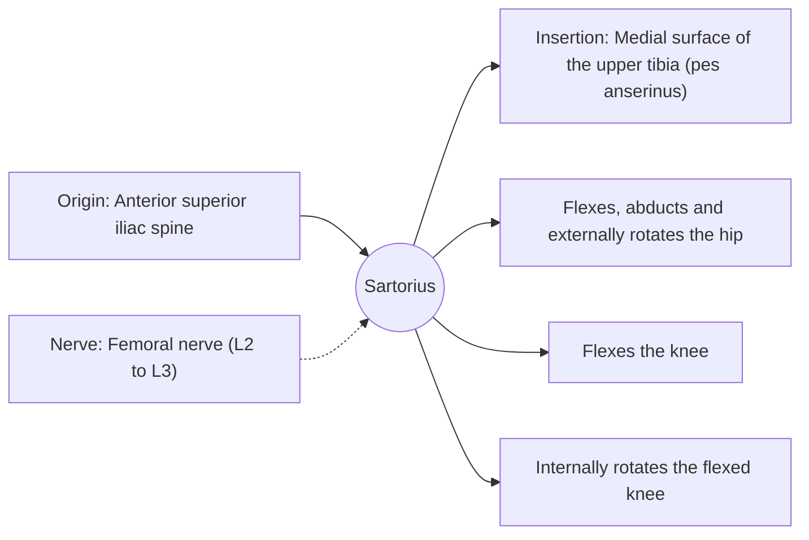

# Sartorius

## Summary

The sartorius is the longest muscle of the body, a thin strap running diagonally across the front of the thigh from the hip to the inner knee. It flexes, abducts and externally rotates the hip and flexes the knee, the combination used when sitting cross-legged, the "tailor's position" that gives it its name.

## Prerequisites

- [Muscular system overview](../muscular-system-overview.md)

## Core concepts

### Definition

The *sartorius* ("tailor's muscle") is a long, parallel-fibered two-joint muscle in the anterior compartment of the thigh.

### Analogy

The sartorius is like a long diagonal strap from the front of the pelvis to the inside of the shin: pulling it lifts the foot onto the opposite knee. The analogy breaks because, being long and thin, it shortens a lot but produces little force.

### Mechanism

Its long parallel fibers make it built for range of motion rather than force, a contrast to pennate muscles like the quadriceps (see [Muscle classification](../muscle-classification.md#why-fiber-arrangement-matters)).

The diagram shows the attachments, the nerve and the actions.

### Attachments and innervation

| Feature | Description |
| --- | --- |
| Latin name | *musculus sartorius* |
| Origin | Anterior superior iliac spine |
| Insertion | Medial surface of the upper tibia (pes anserinus) |
| Innervation | Femoral nerve (L2 to L3) |
| Actions | Flexes, abducts and externally rotates the hip; Flexes the knee; Internally rotates the flexed knee |

### Exercises and tests

Not usually trained alone; works in hip flexion and in movements like placing the foot on the opposite knee.

## Worked example

In adolescent sprinters, a forceful start can pull off the bone fragment where the sartorius attaches at the anterior superior iliac spine (avulsion fracture), because the growth plate there is weaker than the tendon.

## Trade offs and when to use it

Long range, low force; a landmark forming the lateral border of the femoral triangle.

## Common mistakes

- **Ranking muscles by length and strength together.** The longest muscle is weak; force depends on cross-sectional area.

## Practice

1. What combination of movements does the sartorius produce?
2. Where does it originate?

### Answers

1. Hip flexion, abduction and external rotation, with knee flexion, as in sitting cross-legged.
2. At the anterior superior iliac spine.

## Further reading

- Standring, S. (Ed.) (2020). *Gray's Anatomy: The Anatomical Basis of Clinical Practice (42nd ed.)*. Elsevier. Reference text for attachments, innervation and relations.
- Betts, J. G., Young, K. A., Wise, J. A. et al. (2022). *Anatomy and Physiology 2e*. OpenStax, Rice University. [Link](https://openstax.org/details/books/anatomy-and-physiology-2e). Open textbook with illustrations of the skeletal and muscular systems.
