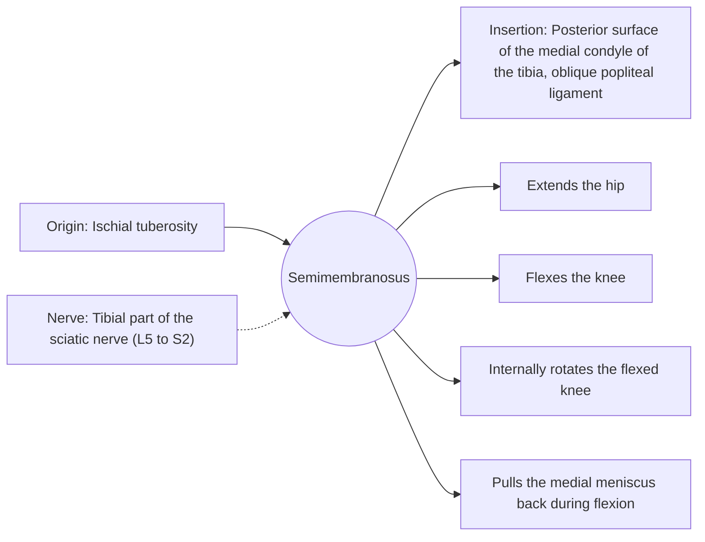

# Semimembranosus

## Summary

The semimembranosus is the deep medial hamstring, named for its broad, flat, membrane-like upper tendon. It extends the hip, flexes the knee and rotates the bent knee inward, and it pulls the medial meniscus backward during knee flexion.

## Prerequisites

- [Muscular system overview](../muscular-system-overview.md)

## Core concepts

### Definition

The *semimembranosus* lies deep to the semitendinosus and inserts on the back of the medial condyle of the tibia, with expansions to the knee capsule.

### Analogy

The semimembranosus is like a broad belt rather than a rope at its upper end, spreading force over a wide area. The analogy breaks because at its lower end it splits into several slips to the tibia and the capsule.

### Mechanism

Its attachments to the knee capsule tighten the back of the knee and protect the medial meniscus from being trapped.

The diagram shows the attachments, the nerve and the actions.

### Attachments and innervation

| Feature | Description |
| --- | --- |
| Latin name | *musculus semimembranosus* |
| Origin | Ischial tuberosity |
| Insertion | Posterior surface of the medial condyle of the tibia, oblique popliteal ligament |
| Innervation | Tibial part of the sciatic nerve (L5 to S2) |
| Actions | Extends the hip; Flexes the knee; Internally rotates the flexed knee; Pulls the medial meniscus back during flexion |

### Exercises and tests

As for the other hamstrings.

## Worked example

A Baker cyst, a fluid-filled swelling at the back of the knee, typically forms between the semimembranosus and the medial head of the gastrocnemius, often with knee osteoarthritis or meniscus tears.

## Trade offs and when to use it

Deep stabilizer of the back of the knee as well as a mover.

## Common mistakes

- **Thinking only the biceps femoris matters in hamstring training.** The medial hamstrings are trained with internal rotation and hip extension.

## Practice

1. What is distinctive about the semimembranosus tendon?
2. Where does a Baker cyst usually form?

### Answers

1. Its upper tendon is broad and flat, like a membrane.
2. Between the semimembranosus and the medial gastrocnemius.

## Further reading

- Standring, S. (Ed.) (2020). *Gray's Anatomy: The Anatomical Basis of Clinical Practice (42nd ed.)*. Elsevier. Reference text for attachments, innervation and relations.
- Betts, J. G., Young, K. A., Wise, J. A. et al. (2022). *Anatomy and Physiology 2e*. OpenStax, Rice University. [Link](https://openstax.org/details/books/anatomy-and-physiology-2e). Open textbook with illustrations of the skeletal and muscular systems.
