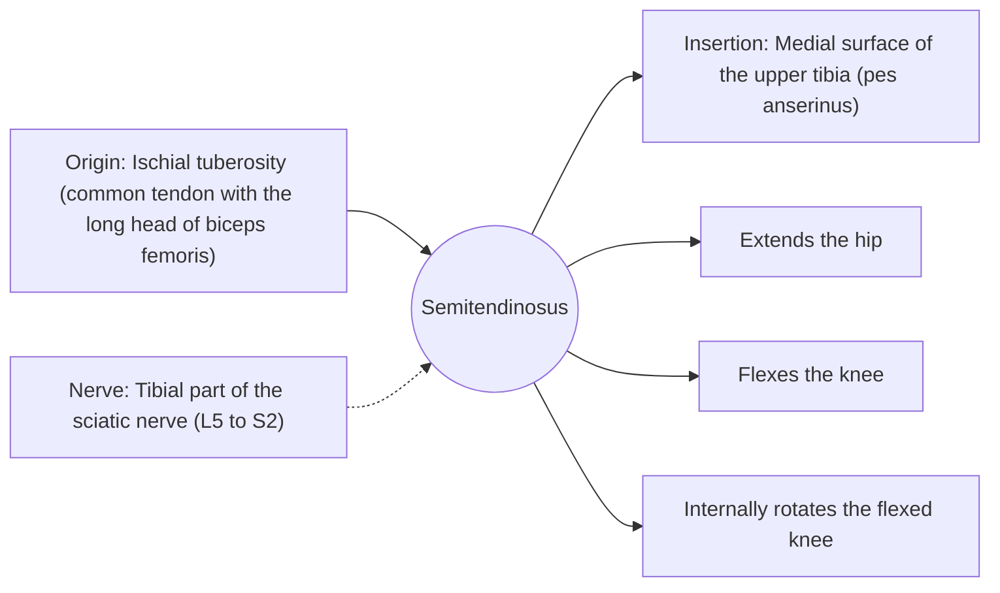

# Semitendinosus

## Summary

The semitendinosus is a medial hamstring with a long, cord-like tendon in its lower half. It extends the hip, flexes the knee and rotates the bent knee inward. Its tendon is often used as a graft to reconstruct a torn anterior cruciate ligament.

## Prerequisites

- [Muscular system overview](../muscular-system-overview.md)

## Core concepts

### Definition

The *semitendinosus* ("half tendon") lies superficial to the semimembranosus and inserts with the gracilis and sartorius at the pes anserinus on the medial tibia.

### Analogy

The semitendinosus is like a rope that turns into a long thin cord halfway down, light at the end and easy to reroute. That is why surgeons can harvest it for knee ligament repair. The analogy breaks because, after harvest, the tendon often partly regenerates.

### Mechanism

With the sartorius and gracilis it forms the pes anserinus ("goose foot"), which supports the medial knee.

The diagram shows the attachments, the nerve and the actions.

### Attachments and innervation

| Feature | Description |
| --- | --- |
| Latin name | *musculus semitendinosus* |
| Origin | Ischial tuberosity (common tendon with the long head of biceps femoris) |
| Insertion | Medial surface of the upper tibia (pes anserinus) |
| Innervation | Tibial part of the sciatic nerve (L5 to S2) |
| Actions | Extends the hip; Flexes the knee; Internally rotates the flexed knee |

### Exercises and tests

Leg curls with toes turned in, Nordic curls, Romanian deadlifts.

## Worked example

In ACL reconstruction with a hamstring graft, the semitendinosus (often with the gracilis) is harvested and folded to form a new ligament. Knee flexion strength is somewhat reduced afterward, especially at deep flexion, which rehabilitation addresses.

## Trade offs and when to use it

Its long tendon is useful as a graft at a modest cost in flexion strength.

## Common mistakes

- **Confusing pes anserinus pain with a meniscus tear.** Pes anserinus pain is below the joint line on the medial tibia.

## Practice

1. Which three muscles form the pes anserinus?
2. Why is the semitendinosus used for ACL grafts?

### Answers

1. Sartorius, gracilis and semitendinosus.
2. It has a long, strong tendon that can be harvested with limited loss of function.

## Further reading

- Standring, S. (Ed.) (2020). *Gray's Anatomy: The Anatomical Basis of Clinical Practice (42nd ed.)*. Elsevier. Reference text for attachments, innervation and relations.
- Betts, J. G., Young, K. A., Wise, J. A. et al. (2022). *Anatomy and Physiology 2e*. OpenStax, Rice University. [Link](https://openstax.org/details/books/anatomy-and-physiology-2e). Open textbook with illustrations of the skeletal and muscular systems.
