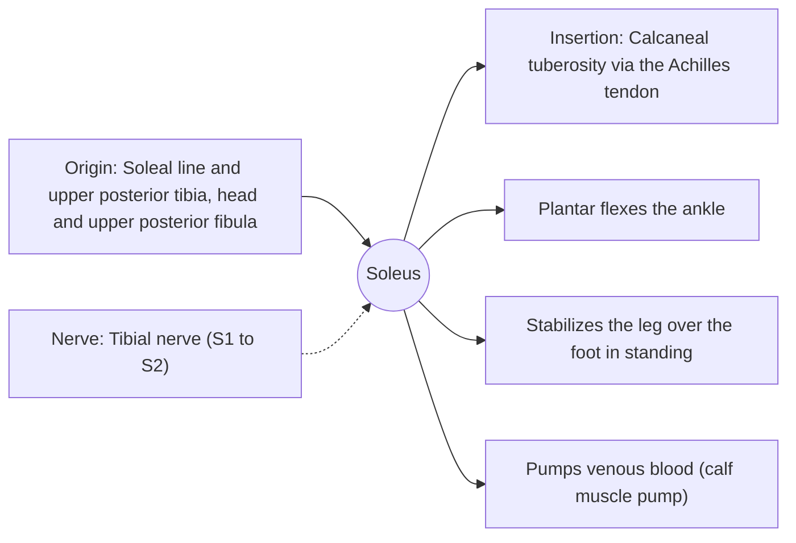

# Soleus

## Summary

The soleus is the broad, flat calf muscle under the gastrocnemius. It crosses only the ankle, plantar flexes it and keeps the body from falling forward when standing. It consists mostly of slow-twitch fibers and acts as a "second heart", pumping venous blood upward when it contracts.

## Prerequisites

- [Muscular system overview](../muscular-system-overview.md)

## Core concepts

### Definition

The *soleus* (from Latin *solea*, sandal or sole fish, for its flat shape) lies deep to the gastrocnemius and joins the Achilles tendon.

### Analogy

The soleus is like a postural guard that never sleeps: in standing, the body tends to sway forward, and the soleus pulls the leg back over the foot again and again. The analogy breaks because it also works as a pump for the veins, squeezing blood back to the heart.

### Mechanism

It contains about 70 to 80 percent type I fibers in most people, suiting it for sustained postural work. Its venous sinuses are emptied with every contraction.

The diagram shows the attachments, the nerve and the actions.

### Attachments and innervation

| Feature | Description |
| --- | --- |
| Latin name | *musculus soleus* |
| Origin | Soleal line and upper posterior tibia, head and upper posterior fibula |
| Insertion | Calcaneal tuberosity via the Achilles tendon |
| Innervation | Tibial nerve (S1 to S2) |
| Actions | Plantar flexes the ankle; Stabilizes the leg over the foot in standing; Pumps venous blood (calf muscle pump) |

### Exercises and tests

Seated calf raises, bent-knee calf raises, walking and running.

## Worked example

Long flights increase the risk of deep vein thrombosis partly because the calf muscle pump is inactive. Regular ankle movements and short walks activate the soleus and gastrocnemius and help venous return.

## Trade offs and when to use it

Fatigue-resistant postural muscle that also serves circulation.

## Common mistakes

- **Neglecting bent-knee calf work in running injury prevention.** The soleus carries the highest loads in running and needs specific training.

## Practice

1. What fiber type dominates the soleus?
2. Why is the soleus called a second heart?

### Answers

1. Type I (slow-twitch).
2. Its contractions pump venous blood back toward the heart.

## Further reading

- Standring, S. (Ed.) (2020). *Gray's Anatomy: The Anatomical Basis of Clinical Practice (42nd ed.)*. Elsevier. Reference text for attachments, innervation and relations.
- Betts, J. G., Young, K. A., Wise, J. A. et al. (2022). *Anatomy and Physiology 2e*. OpenStax, Rice University. [Link](https://openstax.org/details/books/anatomy-and-physiology-2e). Open textbook with illustrations of the skeletal and muscular systems.
