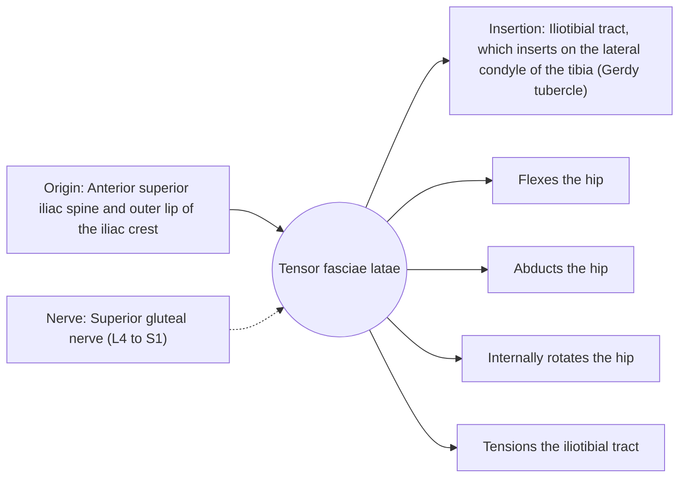

# Tensor fasciae latae

## Summary

The tensor fasciae latae (TFL) is a small muscle at the front of the outer hip that pulls on the iliotibial tract. It flexes, abducts and internally rotates the hip and helps stabilize the knee and pelvis in walking.

## Prerequisites

- [Muscular system overview](../muscular-system-overview.md)

## Core concepts

### Definition

The *tensor fasciae latae* lies between the layers of the fascia lata on the outer front of the hip.

### Analogy

The TFL is like a hand tightening a long strap (the iliotibial tract) running down the outside of the thigh to the knee. Tightening the strap supports the outside of the knee and hip. The analogy breaks because the strap is also tightened by the gluteus maximus from behind.

### Mechanism

With the gluteus medius and minimus, it helps hold the pelvis level in walking. It often compensates when the gluteus medius is weak.

The diagram shows the attachments, the nerve and the actions.

### Attachments and innervation

| Feature | Description |
| --- | --- |
| Latin name | *musculus tensor fasciae latae* |
| Origin | Anterior superior iliac spine and outer lip of the iliac crest |
| Insertion | Iliotibial tract, which inserts on the lateral condyle of the tibia (Gerdy tubercle) |
| Innervation | Superior gluteal nerve (L4 to S1) |
| Actions | Flexes the hip; Abducts the hip; Internally rotates the hip; Tensions the iliotibial tract |

### Exercises and tests

Side-lying abduction (it works more when the hip is slightly flexed and internally rotated).

## Worked example

Iliotibial band syndrome causes pain on the outer knee in runners and cyclists, especially downhill. It is linked to load and hip muscle weakness; foam rolling feels relieving but does not lengthen the iliotibial band, which is very stiff connective tissue.

## Trade offs and when to use it

Useful helper; overuse in compensation for a weak gluteus medius is common.

## Common mistakes

- **Trying to stretch the iliotibial band.** Its stiffness barely changes; work on load and hip strength.

## Practice

1. What does the TFL insert into?
2. Which nerve supplies the TFL?

### Answers

1. The iliotibial tract.
2. The superior gluteal nerve.

## Further reading

- Standring, S. (Ed.) (2020). *Gray's Anatomy: The Anatomical Basis of Clinical Practice (42nd ed.)*. Elsevier. Reference text for attachments, innervation and relations.
- Betts, J. G., Young, K. A., Wise, J. A. et al. (2022). *Anatomy and Physiology 2e*. OpenStax, Rice University. [Link](https://openstax.org/details/books/anatomy-and-physiology-2e). Open textbook with illustrations of the skeletal and muscular systems.
