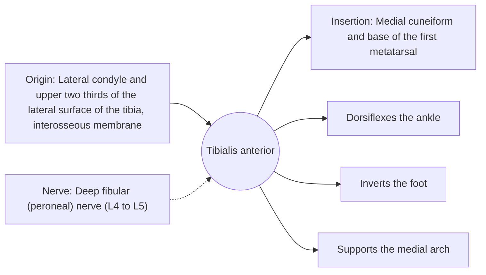

# Tibialis anterior

## Summary

The tibialis anterior runs along the front of the shin next to the tibia. It lifts the foot (dorsiflexion) and turns the sole inward (inversion). In walking, it lifts the toes clear of the ground during swing and lowers the foot gently after heel strike.

## Prerequisites

- [Muscular system overview](../muscular-system-overview.md)

## Core concepts

### Definition

The *tibialis anterior* is the largest muscle of the anterior compartment of the leg. Its tendon can be seen in front of the ankle when the foot is lifted.

### Analogy

The tibialis anterior is like the brake that lowers a drawbridge slowly. After the heel touches the ground, it lets the foot come down under control instead of slapping. The analogy breaks because it also lifts the bridge again for the next step.

### Mechanism

It works eccentrically after heel strike and concentrically in swing. Paralysis from injury to the fibular nerve causes foot drop.

The diagram shows the attachments, the nerve and the actions.

### Attachments and innervation

| Feature | Description |
| --- | --- |
| Latin name | *musculus tibialis anterior* |
| Origin | Lateral condyle and upper two thirds of the lateral surface of the tibia, interosseous membrane |
| Insertion | Medial cuneiform and base of the first metatarsal |
| Innervation | Deep fibular (peroneal) nerve (L4 to L5) |
| Actions | Dorsiflexes the ankle; Inverts the foot; Supports the medial arch |

### Exercises and tests

Toe raises with heels on a step, tibialis raises against a wall, walking on heels.

## Worked example

Foot drop after compression of the common fibular nerve at the fibular neck makes the foot slap after heel strike and the toes catch during swing, so the person lifts the knee high ("steppage gait"). An ankle-foot orthosis can hold the foot up while the nerve recovers.

## Trade offs and when to use it

Small but essential for normal gait; often overloaded in new runners (anterior shin pain).

## Common mistakes

- **Ignoring shin muscle strength in runners.** Tibialis anterior endurance helps control foot landing.

## Practice

1. Which nerve supplies the tibialis anterior?
2. What is foot drop?

### Answers

1. The deep fibular nerve.
2. Inability to lift the foot, often from fibular nerve injury paralyzing the tibialis anterior.

## Further reading

- Standring, S. (Ed.) (2020). *Gray's Anatomy: The Anatomical Basis of Clinical Practice (42nd ed.)*. Elsevier. Reference text for attachments, innervation and relations.
- Betts, J. G., Young, K. A., Wise, J. A. et al. (2022). *Anatomy and Physiology 2e*. OpenStax, Rice University. [Link](https://openstax.org/details/books/anatomy-and-physiology-2e). Open textbook with illustrations of the skeletal and muscular systems.
