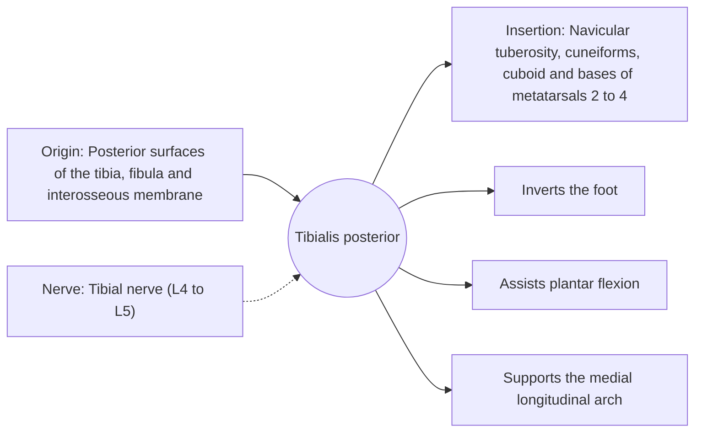

# Tibialis posterior

## Summary

The tibialis posterior is the deepest calf muscle. Its tendon passes behind the inner ankle bone and spreads under the foot. It inverts the foot, assists plantar flexion and is the main dynamic support of the medial arch. Dysfunction of its tendon is a common cause of adult flat foot.

## Prerequisites

- [Muscular system overview](../muscular-system-overview.md)

## Core concepts

### Definition

The *tibialis posterior* lies between the tibia and fibula in the deep posterior compartment of the leg. It is often described as unipennate or bipennate; sources differ.

### Analogy

The tibialis posterior is like a sling under the arch of a bridge, holding it up from below. If the sling stretches, the arch sags. The analogy breaks because the sling also turns the foot inward.

### Mechanism

In walking, it controls pronation of the foot after heel strike and stiffens the midfoot for push-off.

The diagram shows the attachments, the nerve and the actions.

### Attachments and innervation

| Feature | Description |
| --- | --- |
| Latin name | *musculus tibialis posterior* |
| Origin | Posterior surfaces of the tibia, fibula and interosseous membrane |
| Insertion | Navicular tuberosity, cuneiforms, cuboid and bases of metatarsals 2 to 4 |
| Innervation | Tibial nerve (L4 to L5) |
| Actions | Inverts the foot; Assists plantar flexion; Supports the medial longitudinal arch |

### Exercises and tests

Resisted inversion with a band, single-leg calf raises with a ball between the heels, walking barefoot on varied surfaces.

## Worked example

Posterior tibial tendon dysfunction typically affects women over 40. The arch gradually collapses, the heel turns outward, and the person cannot rise on the toes of one foot. Early stages are treated with orthoses and strengthening.

## Trade offs and when to use it

Key arch support; its tendon has a poorly vascularized zone behind the medial malleolus.

## Common mistakes

- **Treating adult-acquired flat foot as only a footwear problem.** Tendon dysfunction needs assessment and targeted treatment.

## Practice

1. Which arch does the tibialis posterior support?
2. What test shows tibialis posterior dysfunction?

### Answers

1. The medial longitudinal arch.
2. Inability to perform a single-leg heel raise.

## Further reading

- Standring, S. (Ed.) (2020). *Gray's Anatomy: The Anatomical Basis of Clinical Practice (42nd ed.)*. Elsevier. Reference text for attachments, innervation and relations.
- Betts, J. G., Young, K. A., Wise, J. A. et al. (2022). *Anatomy and Physiology 2e*. OpenStax, Rice University. [Link](https://openstax.org/details/books/anatomy-and-physiology-2e). Open textbook with illustrations of the skeletal and muscular systems.
