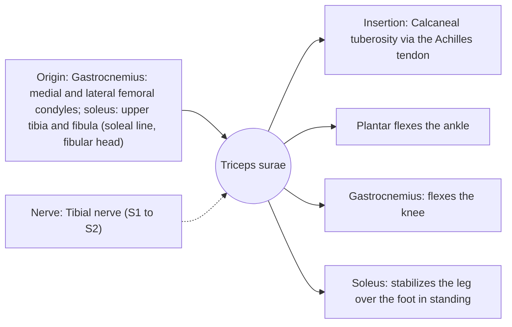

# Triceps surae

## Summary

The triceps surae is the calf muscle group formed by the two heads of the gastrocnemius and the soleus, joined in the Achilles tendon, the thickest tendon in the body. It plantar flexes the ankle (pointing the foot and rising on the toes) and is essential for walking, running and jumping.

## Prerequisites

- [Muscular system overview](../muscular-system-overview.md)

## Core concepts

### Definition

The *triceps surae* ("three-headed calf muscle") consists of the medial and lateral heads of the gastrocnemius and the soleus, inserting via the calcaneal (Achilles) tendon on the calcaneus.

### Analogy

The triceps surae is like a stiff spring at the back of the ankle: in running, the Achilles tendon stretches as the body lands and recoils at push-off, returning stored energy. The muscles keep the spring at the right tension. The analogy breaks because the "spring" also adapts its stiffness to training.

### Mechanism

In running, the Achilles tendon can carry forces of about 6 to 8 times body weight. The soleus is the main plantar flexor when the knee is bent; the gastrocnemius contributes more when the knee is straight.

The diagram shows the attachments, the nerve and the actions.

### Attachments and innervation

| Feature | Description |
| --- | --- |
| Latin name | *musculus triceps surae* |
| Origin | Gastrocnemius: medial and lateral femoral condyles; soleus: upper tibia and fibula (soleal line, fibular head) |
| Insertion | Calcaneal tuberosity via the Achilles tendon |
| Innervation | Tibial nerve (S1 to S2) |
| Actions | Plantar flexes the ankle; Gastrocnemius: flexes the knee; Soleus: stabilizes the leg over the foot in standing |

### Muscles

| Muscle | Crosses | Fiber type | Note |
| --- | --- | --- | --- |
| [Gastrocnemius](gastrocnemius.md) | Knee and ankle | Mixed, more fast fibers | Visible two-headed calf |
| [Soleus](soleus.md) | Ankle only | Mostly slow (type I) | Postural, beneath gastrocnemius |

### Exercises and tests

Standing calf raises (gastrocnemius), seated calf raises (soleus), jumping, skipping.

## Worked example

Achilles tendinopathy causes morning stiffness and pain a few centimeters above the heel in runners. Progressive heavy and eccentric calf raises are the best supported treatment, usually over three months.

## Trade offs and when to use it

A stiff energy-saving spring, but the tendon can degenerate under repeated high loads.

## Common mistakes

- **Training calves only with straight knees.** Bent-knee calf raises are needed for the soleus.

## Practice

1. Which muscles form the triceps surae?
2. Which nerve supplies them?
3. Which calf muscle works mainly when the knee is bent?

### Answers

1. The two heads of the gastrocnemius and the soleus.
2. The tibial nerve.
3. The soleus.

## Further reading

- Standring, S. (Ed.) (2020). *Gray's Anatomy: The Anatomical Basis of Clinical Practice (42nd ed.)*. Elsevier. Reference text for attachments, innervation and relations.
- Betts, J. G., Young, K. A., Wise, J. A. et al. (2022). *Anatomy and Physiology 2e*. OpenStax, Rice University. [Link](https://openstax.org/details/books/anatomy-and-physiology-2e). Open textbook with illustrations of the skeletal and muscular systems.
