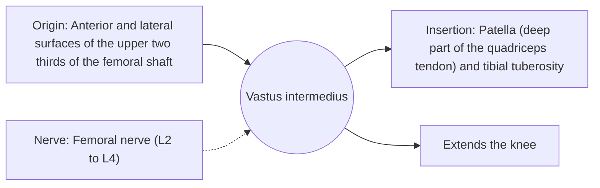

# Vastus intermedius

## Summary

The vastus intermedius is the deep quadriceps head lying on the front of the femur under the rectus femoris. It extends the knee. Below it, a small articularis genus muscle pulls the knee joint capsule up during extension.

## Prerequisites

- [Muscular system overview](../muscular-system-overview.md)

## Core concepts

### Definition

The *vastus intermedius* covers the anterior and lateral surfaces of the femoral shaft.

### Analogy

The vastus intermedius is the hidden rope at the bottom of the quadriceps bundle. The analogy breaks because it has a helper, the articularis genus, that lifts the capsule so it is not pinched.

### Mechanism

It works with the other vasti in every knee extension.

The diagram shows the attachments, the nerve and the actions.

### Attachments and innervation

| Feature | Description |
| --- | --- |
| Latin name | *musculus vastus intermedius* |
| Origin | Anterior and lateral surfaces of the upper two thirds of the femoral shaft |
| Insertion | Patella (deep part of the quadriceps tendon) and tibial tuberosity |
| Innervation | Femoral nerve (L2 to L4) |
| Actions | Extends the knee |

### Exercises and tests

As for the quadriceps.

## Worked example

A thigh contusion ("dead leg") from a knee to the front of the thigh often crushes the vastus intermedius against the femur. Large bruises here can occasionally calcify (myositis ossificans), which is why early gentle movement and avoiding massage of a fresh bruise are advised.

## Trade offs and when to use it

Deep and protected, but vulnerable to being crushed against the bone.

## Common mistakes

- **Massaging a fresh deep thigh bruise.** This may increase the risk of calcification.

## Practice

1. Which quadriceps head lies on the femur under the rectus femoris?
2. What does the articularis genus do?

### Answers

1. The vastus intermedius.
2. It pulls the knee capsule up during extension.

## Further reading

- Standring, S. (Ed.) (2020). *Gray's Anatomy: The Anatomical Basis of Clinical Practice (42nd ed.)*. Elsevier. Reference text for attachments, innervation and relations.
- Betts, J. G., Young, K. A., Wise, J. A. et al. (2022). *Anatomy and Physiology 2e*. OpenStax, Rice University. [Link](https://openstax.org/details/books/anatomy-and-physiology-2e). Open textbook with illustrations of the skeletal and muscular systems.
