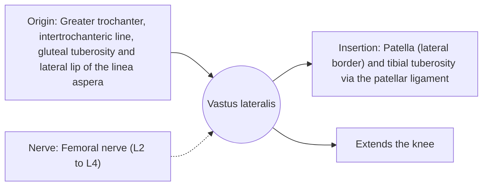

# Vastus lateralis

## Summary

The vastus lateralis is the largest head of the quadriceps, on the outer side of the thigh. It extends the knee and is the muscle most often sampled in muscle biopsy studies.

## Prerequisites

- [Muscular system overview](../muscular-system-overview.md)

## Core concepts

### Definition

The *vastus lateralis* is a large muscle forming the bulk of the lateral thigh.

### Analogy

The vastus lateralis is the strongest rope of the quadriceps cable, pulling slightly outward on the patella. The analogy breaks because its pull is balanced by the vastus medialis, keeping the patella centered.

### Mechanism

Its size makes it the main contributor to knee extension force. Because it is accessible, most human research on fiber types and training adaptations uses biopsies from this muscle.

The diagram shows the attachments, the nerve and the actions.

### Attachments and innervation

| Feature | Description |
| --- | --- |
| Latin name | *musculus vastus lateralis* |
| Origin | Greater trochanter, intertrochanteric line, gluteal tuberosity and lateral lip of the linea aspera |
| Insertion | Patella (lateral border) and tibial tuberosity via the patellar ligament |
| Innervation | Femoral nerve (L2 to L4) |
| Actions | Extends the knee |

### Exercises and tests

Squats, leg presses, leg extensions, lunges.

## Worked example

Fiber type data quoted in exercise science, such as "sprinters have 70 percent fast-twitch fibers", usually come from vastus lateralis biopsies, so they describe this muscle, not the whole body.

## Trade offs and when to use it

Large and strong; its pull must be balanced to keep the patella tracking well.

## Common mistakes

- **Generalizing fiber type data from one muscle to all muscles.** Fiber types differ between muscles.

## Practice

1. Which is the largest head of the quadriceps?
2. Why is it used in biopsy studies?

### Answers

1. The vastus lateralis.
2. It is large and easily accessible.

## Further reading

- Standring, S. (Ed.) (2020). *Gray's Anatomy: The Anatomical Basis of Clinical Practice (42nd ed.)*. Elsevier. Reference text for attachments, innervation and relations.
- Betts, J. G., Young, K. A., Wise, J. A. et al. (2022). *Anatomy and Physiology 2e*. OpenStax, Rice University. [Link](https://openstax.org/details/books/anatomy-and-physiology-2e). Open textbook with illustrations of the skeletal and muscular systems.
