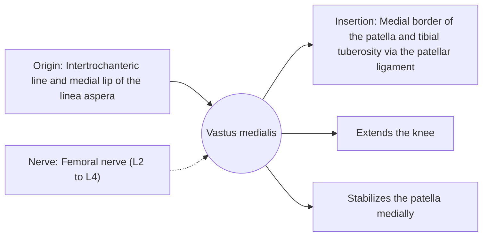

# Vastus medialis

## Summary

The vastus medialis is the quadriceps head on the inner side of the thigh, forming the teardrop bulge above the knee. Its lowest fibers (vastus medialis obliquus) pull the patella inward and help it track centrally.

## Prerequisites

- [Muscular system overview](../muscular-system-overview.md)

## Core concepts

### Definition

The *vastus medialis* runs from the medial femur to the medial border of the patella. Its distal oblique fibers are often called the vastus medialis obliquus (VMO).

### Analogy

The vastus medialis is like the inside rein on a horse that keeps it from drifting outward. The analogy breaks because the idea that it can be activated in isolation from the other vasti is not supported.

### Mechanism

It is active throughout knee extension, not only in the last 30 degrees as once claimed. Its oblique fibers resist lateral movement of the patella.

The diagram shows the attachments, the nerve and the actions.

### Attachments and innervation

| Feature | Description |
| --- | --- |
| Latin name | *musculus vastus medialis* |
| Origin | Intertrochanteric line and medial lip of the linea aspera |
| Insertion | Medial border of the patella and tibial tuberosity via the patellar ligament |
| Innervation | Femoral nerve (L2 to L4) |
| Actions | Extends the knee; Stabilizes the patella medially |

### Exercises and tests

Squats, lunges, step-downs, leg extensions.

## Worked example

The vastus medialis is the first part of the quadriceps to visibly waste after knee injury or surgery. Rebuilding it is part of standard knee rehabilitation, using general quadriceps exercises rather than "isolated VMO" drills.

## Trade offs and when to use it

Important for patellar tracking; cannot be trained separately from the other heads.

## Common mistakes

- **Believing terminal knee extension isolates the VMO.** Studies show the vasti activate together.

## Practice

1. What does the oblique part of the vastus medialis do?
2. Can the VMO be trained in isolation?

### Answers

1. It pulls the patella medially and stabilizes it.
2. No, the vasti activate together.

## Further reading

- Standring, S. (Ed.) (2020). *Gray's Anatomy: The Anatomical Basis of Clinical Practice (42nd ed.)*. Elsevier. Reference text for attachments, innervation and relations.
- Betts, J. G., Young, K. A., Wise, J. A. et al. (2022). *Anatomy and Physiology 2e*. OpenStax, Rice University. [Link](https://openstax.org/details/books/anatomy-and-physiology-2e). Open textbook with illustrations of the skeletal and muscular systems.
