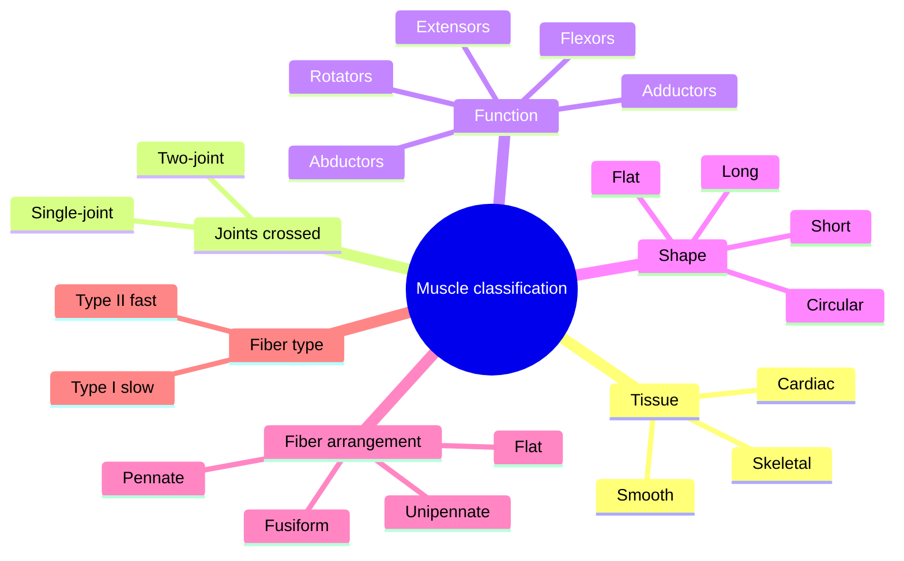

# Muscle classification

## Summary

Muscles can be grouped in several ways, each useful for a different question. By tissue, there is smooth, skeletal and cardiac muscle. By mechanics, muscles cross one joint or two. By function, they are extensors, flexors, adductors, abductors and rotators. By shape, they are long, short, flat or circular. By the arrangement of fibers relative to the tendon, they are pennate, unipennate, flat or fusiform. By fiber type, they are dominated by slow-twitch (type I) or fast-twitch (type II) fibers.

## Prerequisites

- [Muscular system overview](muscular-system-overview.md)

## Core concepts

### Definition

A *muscle classification* is a way of grouping muscles by a shared property. No single scheme is complete; anatomists, physiologists and coaches use the one that fits their question.

### Analogy

Classifying muscles is like sorting vehicles: by engine type (tissue), by number of axles (joints crossed), by job (function: trucks, buses), by body shape (shape) and by how the frame is built (fiber arrangement). The same vehicle appears in several categories. The analogy breaks because a muscle's "job" changes with the movement: the same muscle can be a flexor in one exercise and a stabilizer in another.

### Mechanism

**By tissue structure** (the most common division):

- **Smooth muscle** is widespread: in the walls of blood vessels, the digestive tract, the skin and many internal organs. Its cells are spindle-shaped with a nucleus in the middle; the cytoplasm contains a Golgi apparatus, mitochondria and thin, long contractile filaments typical of this tissue.
- **Skeletal striated muscle** has many nuclei per cell, a Golgi apparatus, mitochondria and endoplasmic reticulum (sarcoplasmic reticulum). The inside of the fiber is almost filled with contractile myofibrils. It forms the skeletal muscles.
- **Cardiac striated muscle** also has elongated fibers, but unlike skeletal fibers they branch. It forms the heart muscle.

More detail on the three tissues is in [Tissues](../../../../natural-sciences/biology/cell-biology/tissues.md#the-three-muscle-tissues).

**By mechanics** (number of joints crossed):

- **Single-joint (monoarticular)**: contraction moves one joint, for example tibialis anterior and brachialis.
- **Two-joint (biarticular)**: contraction moves two joints, for example rectus femoris (hip and knee) and biceps brachii (shoulder and elbow).

**By function:**

- Extensors, for example the quadriceps femoris extends the knee.
- Flexors, for example the biceps brachii flexes the elbow.
- Adductors, for example the adductor magnus adducts the hip.
- Abductors, for example the gluteus medius abducts the hip. The piriformis abducts the hip when the hip is flexed and rotates it laterally when the hip is straight.
- Internal and external rotators, for example the teres minor rotates the arm externally.

**By shape:**

- **Long** muscles are elongated and found mainly in the limbs.
- **Short** muscles vary in shape, for example the small muscles between vertebrae.
- **Flat** muscles have flat bellies and tendons (aponeuroses) and are found mainly on the trunk and in the pelvis.
- **Circular** (mixed) muscles surround the mouth, eyes or anus (sphincters).

**By fiber arrangement relative to the tendon:**

- **Pennate (bipennate)**: fibers attach obliquely on both sides of a central tendon, for example dorsal interossei and rectus femoris. The lumbricals are often listed here, though they are better described as fusiform.
- **Unipennate (semipennate)**: fibers on one side of the tendon, for example tibialis posterior and fibularis brevis (sources differ on the exact type of tibialis posterior).
- **Flat (parallel sheets)**: for example the abdominal muscles.
- **Fusiform**: spindle-shaped with fibers running roughly parallel to the line of pull, for example biceps brachii. The gluteal muscles are sometimes listed as fusiform but are better described as broad, multi-fascicular muscles.

**By fiber type:**

- **Mainly type I (slow-twitch, ST)**: also called red fibers because of their myoglobin. Adapted for long work at lower intensity because they fatigue slowly. They contract slowly and with relatively low force, which they make up for in endurance. Example: soleus.
- **Mainly type II (fast-twitch, FT)**: also called white fibers. Able to produce large forces quickly but fatigue fast. They have fewer capillaries and rely more on anaerobic (glycolytic) metabolism. Example: much of the gastrocnemius and vastus lateralis in sprinters.

See [Muscle fiber types](../../physiology/muscle/muscle-fiber-types.md).

The map shows the classification schemes.

### Why fiber arrangement matters

Pennate muscles pack more fibers into the same volume, so they have a larger *physiological cross-sectional area* and produce more force, but their fibers are shorter, so they shorten less and more slowly. Fusiform muscles with long parallel fibers shorten over a greater distance and faster. The quadriceps (pennate) is built for force; the sartorius (long, parallel) for range.

## Worked example

Why does a seated leg curl feel different from a lying leg curl? The hamstrings are two-joint muscles crossing the hip and knee. In the seated version the hip is flexed, which stretches the hamstrings at the hip, so they work at a longer length. A 2021 study (Maeo and colleagues) found greater hamstring growth with seated than with lying leg curls over 12 weeks. Knowing which muscles are two-joint helps choose exercises that train them at long lengths.

## Trade offs and when to use it

- Functional labels describe a muscle's action in the anatomical position; in real movement the same muscle may stabilize, decelerate or reverse its role.
- Fiber type proportions vary between people and are partly genetic; training shifts them only modestly between subtypes of type II.

## Common mistakes

- **Treating "muscle function" as fixed.** It depends on joint position and the movement.
- **Assuming bigger fibers equal faster fibers.** Speed depends on myosin type, not size.

## Practice

1. Give an example of a two-joint muscle.
2. Why can pennate muscles produce more force for their size?
3. Which fiber type is called "red", and why?

### Answers

1. Rectus femoris, biceps brachii or the hamstrings.
2. They pack more fibers into the same volume, giving a larger physiological cross-sectional area.
3. Type I (slow-twitch) fibers, because they contain more myoglobin and capillaries.

## Further reading

- Standring, S. (Ed.) (2020). *Gray's Anatomy: The Anatomical Basis of Clinical Practice (42nd ed.)*. Elsevier. Reference text for attachments, innervation and relations.
- Betts, J. G., Young, K. A., Wise, J. A. et al. (2022). *Anatomy and Physiology 2e*. OpenStax, Rice University. [Link](https://openstax.org/details/books/anatomy-and-physiology-2e). Open textbook with illustrations of the skeletal and muscular systems.
- Maeo, S., Huang, M., Wu, Y. et al. (2021). Greater hamstrings muscle hypertrophy but similar damage protection after training at long versus short muscle lengths. Medicine and Science in Sports and Exercise, 53(4), 825-837. [DOI](https://doi.org/10.1249/MSS.0000000000002523). Trial comparing seated and lying leg curls for hamstring growth.
