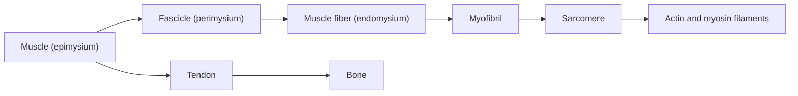
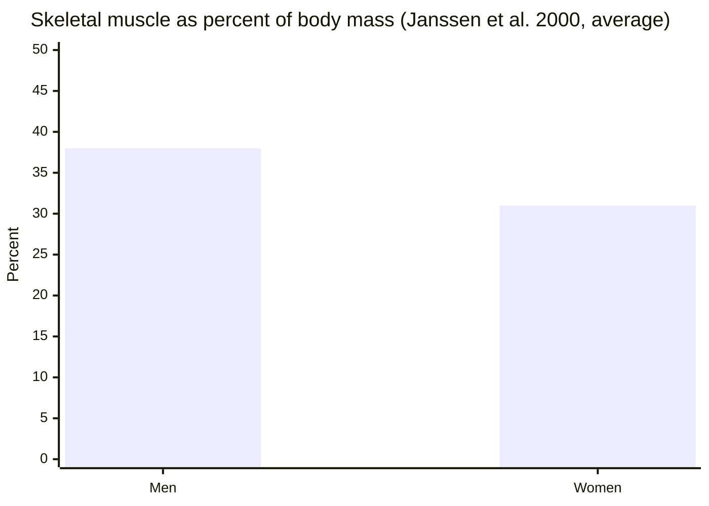

# Muscular system overview

## Summary

A muscle (*musculus*) is a contractile organ, the active part of the locomotor system, made of muscle tissue. Skeletal muscles are attached to bones by tendons; when they contract, they pull the bones and move them relative to each other at joints. Humans have roughly 600 skeletal muscles by most modern counts, although older counts range from about 300 to 500 depending on what is counted. Skeletal muscle makes up about 30 to 40 percent of body mass, more in men than in women. Muscles run on ATP, regenerated from glycogen stored in the muscle, glucose and fatty acids from the blood, and phosphocreatine.

## Prerequisites

- [Skeletal system overview](../skeletal-system/skeletal-system-overview.md)
- [Tissues](../../../../natural-sciences/biology/cell-biology/tissues.md)

## Core concepts

### Definition

A *muscle* is a contractile organ, one of the structural and functional elements of the locomotor system, of which it is the active part (bones and joints are the passive part). Muscles occur in higher invertebrates and in vertebrates, and their shape and structure depend on their role. A skeletal muscle consists of muscle fibers (cells) bundled into fascicles, wrapped in connective tissue sheaths that merge into tendons at each end. Movement requires something to pull against: in vertebrates the hard skeleton, in worms a fluid-filled hydrostatic skeleton.

### Analogy

A skeletal muscle is like a team of rowers pulling ropes: each rower (muscle fiber) can only pull, never push, and the rope (tendon) transmits the pull to the boat (bone). To move the boat back, a second team on the other side must pull. This is why muscles work in opposing pairs. The analogy breaks because muscle fibers are recruited in organized units (motor units), not as individuals choosing to pull.

### Mechanism

**From whole muscle to molecules.** Muscle → fascicle → muscle fiber (a single cell up to several centimeters long with many nuclei) → myofibrils → sarcomeres, the contractile units in which actin and myosin filaments slide past each other (see [Muscle contraction](../../physiology/muscle/muscle-contraction.md)).

**Connective tissue layers.** The epimysium wraps the whole muscle, the perimysium each fascicle and the endomysium each fiber. They converge into the tendon, which attaches to bone.

**Origin and insertion.** By convention, the *origin* is the attachment that usually stays fixed (often proximal), and the *insertion* is the attachment that moves. In closed-chain movements the roles can reverse: in a pull-up, the latissimus dorsi pulls the trunk up to the fixed arm.

**Energy.** Muscles use ATP, regenerated from phosphocreatine, from glycogen stored in the muscle and from glucose and fatty acids delivered by the blood (see [Energy systems](../../physiology/energy-systems.md)).

The diagram shows the levels of organization.

### How many muscles

Counts differ because authors disagree on whether to count paired muscles once or twice, muscles with several heads as one or several, and tiny muscles such as the arrector pili of hair follicles (usually excluded). An older count by Eisler gave 329 skeletal muscles plus 49 striated muscles of the viscera and sense organs. Many modern sources state about 600 to 650 skeletal muscles.

### How much muscle

Muscle mass percentages are often confused with fat-free mass. Using MRI, Janssen and colleagues (2000) measured skeletal muscle at about 38 percent of body mass in men and 31 percent in women on average, declining with age, especially after about 45. Fat-free mass (muscle plus organs, bone and water) is much higher, often 65 to 85 percent of body mass, which is the source of some higher figures quoted for "muscle". The difference between men and women reflects more fat tissue and less muscle on average in women.

## Worked example

A 80 kg man with 38 percent skeletal muscle carries about 30 kg of muscle. At rest, skeletal muscle uses roughly 13 kcal per kg per day, so his muscle accounts for about 400 kcal of a resting energy use of about 1,800 kcal per day. Organs such as liver, brain, heart and kidneys use far more per kilogram. Gaining 2 kg of muscle raises resting energy use by only about 25 kcal a day, which is less than often claimed in fitness marketing.

## Trade offs and when to use it

- Muscle is metabolically active and protects against falls and disease in older age, but it is expensive to maintain, and the body loses it quickly with disuse.
- Muscle counts and percentages vary by method and definition; quote the source.

## Common mistakes

- **Saying muscles push.** Muscles can only pull; pushing movements are produced by muscles pulling on levers.
- **Equating fat-free mass with muscle mass.** Fat-free mass also includes bone, organs and water.
- **Overestimating the calorie cost of muscle.** Each extra kilogram adds only about 13 kcal per day at rest.

## Practice

1. Name the connective tissue layers of a muscle from outside to inside.
2. Why do muscles work in opposing pairs?
3. Roughly what share of body mass is skeletal muscle in an average man and woman?

### Answers

1. Epimysium, perimysium and endomysium.
2. Muscles can only pull, so another muscle must pull in the opposite direction to reverse a movement.
3. About 38 percent in men and 31 percent in women.

## Further reading

- Standring, S. (Ed.) (2020). *Gray's Anatomy: The Anatomical Basis of Clinical Practice (42nd ed.)*. Elsevier. Reference text for attachments, innervation and relations.
- Betts, J. G., Young, K. A., Wise, J. A. et al. (2022). *Anatomy and Physiology 2e*. OpenStax, Rice University. [Link](https://openstax.org/details/books/anatomy-and-physiology-2e). Open textbook with illustrations of the skeletal and muscular systems.
- Janssen, I., Heymsfield, S. B., Wang, Z. et al. (2000). Skeletal muscle mass and distribution in 468 men and women aged 18-88 yr. Journal of Applied Physiology, 89(1), 81-88. [DOI](https://doi.org/10.1152/jappl.2000.89.1.81). MRI study of skeletal muscle mass in men and women.
