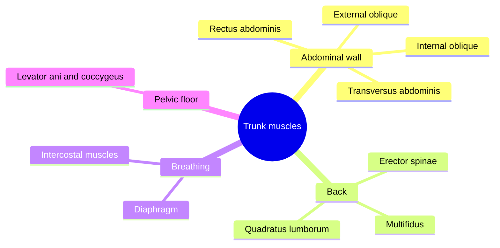

# Trunk muscles

The trunk muscles hold the spine upright, protect the abdominal organs, move the trunk, create the pressure needed for breathing, coughing and lifting, and close the pelvic outlet. The abdominal wall, the back muscles, the diaphragm and the pelvic floor together form a pressurized cylinder around the lumbar spine, the basis of the "core" concept.

## Map

## Reading order

1. [Rectus abdominis](rectus-abdominis.md)
2. [External oblique](external-oblique.md)
3. [Internal oblique](internal-oblique.md)
4. [Transversus abdominis](transversus-abdominis.md)
5. [Erector spinae](erector-spinae.md)
6. [Multifidus](multifidus.md)
7. [Quadratus lumborum](quadratus-lumborum.md)
8. [Diaphragm](diaphragm.md)
9. [Intercostal muscles](intercostal-muscles.md)
10. [Pelvic floor muscles](pelvic-floor.md)

How these muscles cooperate as the core is explained in [Core stability](../../../exercise-and-fitness/mobility/core.md).
