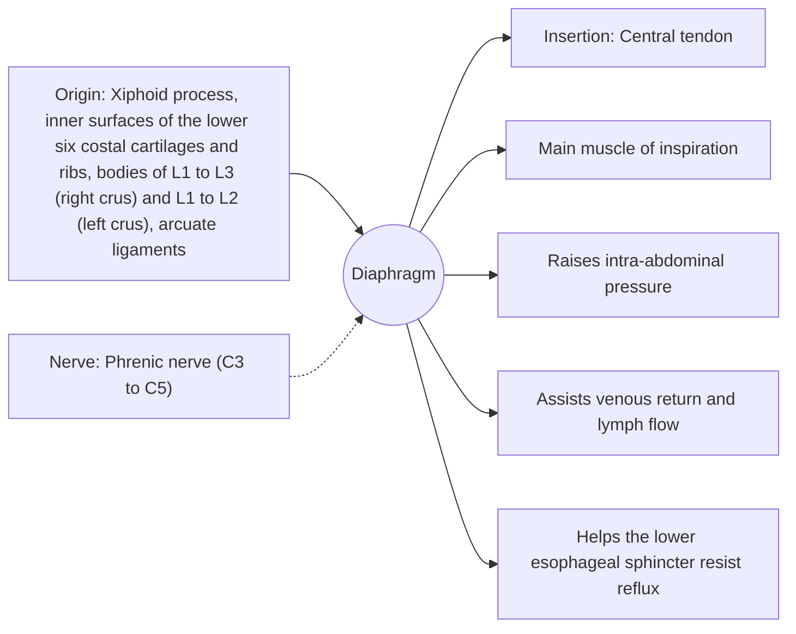

# Diaphragm

## Summary

The diaphragm is a dome-shaped sheet of muscle that separates the chest from the abdomen. It is the main muscle of breathing: when it contracts, the dome flattens, the chest enlarges and air flows in. It also raises abdominal pressure during lifting, coughing and childbirth. It is supplied by the phrenic nerve from C3 to C5.

## Prerequisites

- [Muscular system overview](../muscular-system-overview.md)

## Core concepts

### Definition

The *diaphragm* is a musculotendinous partition with a central tendon and muscle fibers arising from the xiphoid process, the lower six ribs and the lumbar vertebrae (through two crura). It has openings for the esophagus, the aorta and the inferior vena cava.

### Analogy

The diaphragm is like the plunger of a syringe at the bottom of the chest. Pulling the plunger down (contraction) enlarges the space and draws air in; releasing it lets the lungs spring back and push air out. The analogy breaks because the "plunger" is dome-shaped and also pushes down on the abdominal organs.

### Mechanism

Contraction lowers the dome by about 1.5 cm in quiet breathing and up to 7 to 10 cm in deep breathing. This lowers pressure in the chest so air enters (see [Mechanics of breathing](../../../physiology/respiration/mechanics-of-breathing.md)). The rhythm comes from the brainstem breathing centers via the phrenic nerves. "C3, 4 and 5 keep the diaphragm alive" is the classic mnemonic.

The diagram shows the attachments, the nerve and the actions.

### Attachments and innervation

| Feature | Description |
| --- | --- |
| Latin name | *diaphragma* |
| Origin | Xiphoid process, inner surfaces of the lower six costal cartilages and ribs, bodies of L1 to L3 (right crus) and L1 to L2 (left crus), arcuate ligaments |
| Insertion | Central tendon |
| Innervation | Phrenic nerve (C3 to C5) |
| Actions | Main muscle of inspiration; Raises intra-abdominal pressure; Assists venous return and lymph flow; Helps the lower esophageal sphincter resist reflux |

### Openings

| Opening | Level | Passes |
| --- | --- | --- |
| Caval opening | T8 | Inferior vena cava |
| Esophageal hiatus | T10 | Esophagus, vagus nerves |
| Aortic hiatus | T12 | Aorta, thoracic duct |

### Exercises and tests

Diaphragmatic (belly) breathing, breathing techniques ([Breathing techniques in training](../../../physiology/respiration/breathing-techniques.md)), bracing during lifts.

## Worked example

A spinal cord injury at C3 or above stops the phrenic nerve output, and the person needs a ventilator. An injury at C6 leaves the diaphragm working, and the person can breathe independently, although coughing is weak because the abdominal muscles are paralyzed.

## Trade offs and when to use it

One muscle handles most of quiet breathing and contributes to trunk stability, so in heavy lifting with breath-holding, breathing and bracing compete.

## Common mistakes

- **Thinking the lungs draw in air by themselves.** The lungs are passive; the diaphragm and chest wall muscles create the pressure change.

## Practice

1. Which nerve supplies the diaphragm, and from which segments?
2. At which vertebral level does the esophagus pass through the diaphragm?

### Answers

1. The phrenic nerve, from C3 to C5.
2. About T10.

## Further reading

- Standring, S. (Ed.) (2020). *Gray's Anatomy: The Anatomical Basis of Clinical Practice (42nd ed.)*. Elsevier. Reference text for attachments, innervation and relations.
- Betts, J. G., Young, K. A., Wise, J. A. et al. (2022). *Anatomy and Physiology 2e*. OpenStax, Rice University. [Link](https://openstax.org/details/books/anatomy-and-physiology-2e). Open textbook with illustrations of the skeletal and muscular systems.
