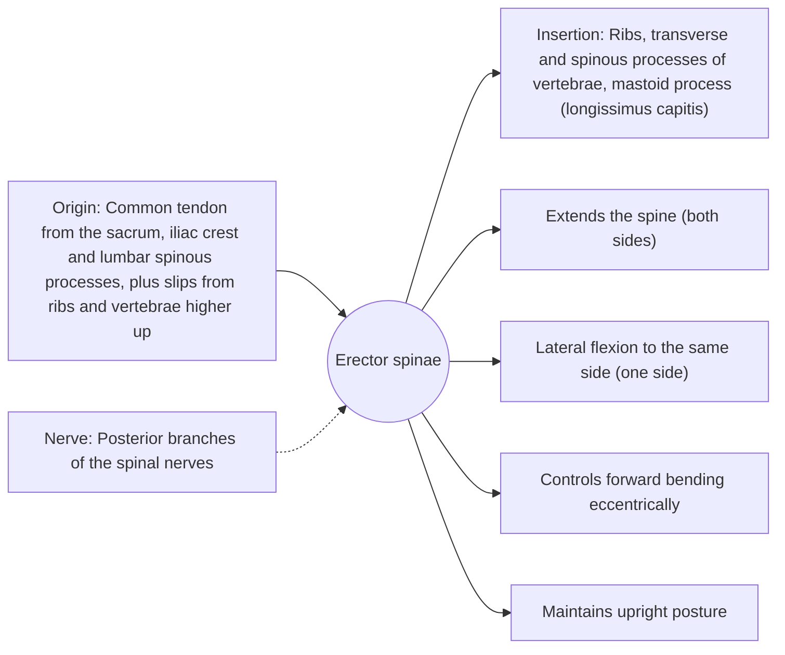

# Erector spinae

## Summary

The erector spinae is a large group of long back muscles running beside the spine from the pelvis to the skull. It has three columns: iliocostalis (lateral), longissimus (middle) and spinalis (medial). It extends the spine, bends it to the side and controls forward bending. It works hard in deadlifts and in holding upright posture.

## Prerequisites

- [Muscular system overview](../muscular-system-overview.md)

## Core concepts

### Definition

The *erector spinae* is a muscle group of the intrinsic (deep) back muscles, lying in a groove on each side of the spinous processes and covered by the thoracolumbar fascia.

### Analogy

The erector spinae is like the set of cables on the back of a crane jib that hold the jib from tipping forward. When you lean forward, these cables lengthen under tension to lower you slowly, and they shorten to lift you back up. The analogy breaks because at full forward bending the cables go quiet and the load shifts to ligaments (the flexion-relaxation phenomenon).

### Mechanism

Each column has lumborum, thoracis, cervicis and capitis parts depending on the region. In the lumbar region, the iliocostalis and longissimus produce most of the extension force. In a deadlift, they hold the spine in a neutral position while the hip extensors (gluteus maximus and hamstrings) lift the load.

The diagram shows the attachments, the nerve and the actions.

### Attachments and innervation

| Feature | Description |
| --- | --- |
| Latin name | *musculus erector spinae* |
| Origin | Common tendon from the sacrum, iliac crest and lumbar spinous processes, plus slips from ribs and vertebrae higher up |
| Insertion | Ribs, transverse and spinous processes of vertebrae, mastoid process (longissimus capitis) |
| Innervation | Posterior branches of the spinal nerves |
| Actions | Extends the spine (both sides); Lateral flexion to the same side (one side); Controls forward bending eccentrically; Maintains upright posture |

### Columns

| Column | Position | Main attachments |
| --- | --- | --- |
| Iliocostalis | Lateral | Iliac crest to the angles of the ribs and cervical transverse processes |
| Longissimus | Middle | Transverse processes; longissimus capitis reaches the mastoid process |
| Spinalis | Medial | Spinous processes, mostly in the thoracic region |

### Exercises and tests

Deadlifts, back extensions, good mornings, bird dogs (with multifidus).

## Worked example

When standing and bending forward slowly to touch the toes, electromyography shows the erector spinae active during the descent, then nearly silent at full flexion, when ligaments and fascia take the load, and active again on the way up. Lifting heavy weights from full spinal flexion therefore loads passive tissues rather than the muscles.

## Trade offs and when to use it

Strong extensors protect the spine in lifting, but they cannot protect it well when the spine is fully flexed.

## Common mistakes

- **Equating "back training" with the erector spinae only.** The multifidus, quadratus lumborum and hip extensors also contribute.

## Practice

1. Name the three columns of the erector spinae from lateral to medial.
2. What is the flexion-relaxation phenomenon?

### Answers

1. Iliocostalis, longissimus and spinalis.
2. The erector spinae become electrically quiet at full forward flexion as passive tissues take the load.

## Further reading

- Standring, S. (Ed.) (2020). *Gray's Anatomy: The Anatomical Basis of Clinical Practice (42nd ed.)*. Elsevier. Reference text for attachments, innervation and relations.
- Betts, J. G., Young, K. A., Wise, J. A. et al. (2022). *Anatomy and Physiology 2e*. OpenStax, Rice University. [Link](https://openstax.org/details/books/anatomy-and-physiology-2e). Open textbook with illustrations of the skeletal and muscular systems.
