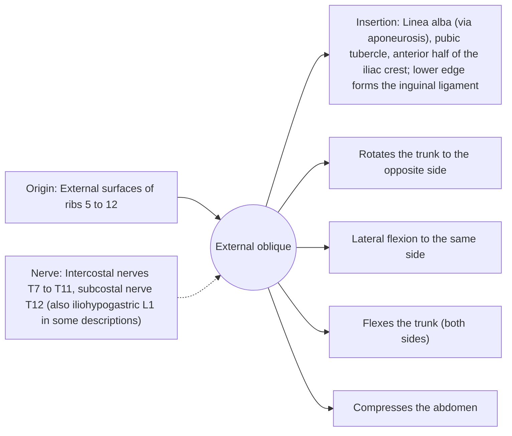

# External oblique

## Summary

The external oblique is the largest and most superficial of the flat abdominal muscles. Its fibers run down and forward like hands in front pockets. It rotates the trunk to the opposite side, bends it to the same side and flexes it, and it compresses the abdomen.

## Prerequisites

- [Muscular system overview](../muscular-system-overview.md)

## Core concepts

### Definition

The *external oblique* arises with eight slips from the lower ribs, interdigitating with the serratus anterior and latissimus dorsi, and ends in a broad aponeurosis that forms the front of the rectus sheath and the inguinal ligament.

### Analogy

The obliques of both sides form a crossed X across the abdomen like the straps of a corset laced diagonally. Pulling one strap twists the trunk. The analogy breaks because the "laces" are living muscle that can also tighten to stiffen the trunk.

### Mechanism

In trunk rotation to the left, the right external oblique works with the left internal oblique. Both obliques resist rotation in anti-rotation exercises such as the Pallof press.

The diagram shows the attachments, the nerve and the actions.

### Attachments and innervation

| Feature | Description |
| --- | --- |
| Latin name | *musculus obliquus externus abdominis* |
| Origin | External surfaces of ribs 5 to 12 |
| Insertion | Linea alba (via aponeurosis), pubic tubercle, anterior half of the iliac crest; lower edge forms the inguinal ligament |
| Innervation | Intercostal nerves T7 to T11, subcostal nerve T12 (also iliohypogastric L1 in some descriptions) |
| Actions | Rotates the trunk to the opposite side; Lateral flexion to the same side; Flexes the trunk (both sides); Compresses the abdomen |

### Exercises and tests

Cable wood chops, Russian twists, side planks, Pallof press (anti-rotation).

## Worked example

The inguinal ligament, the folded lower edge of the external oblique aponeurosis, runs from the anterior superior iliac spine to the pubic tubercle. An inguinal hernia pushes through the canal above it, which is why hernia surgery repairs this region.

## Trade offs and when to use it

Provides rotation power and stiffness; together with the other flat muscles it protects the organs.

## Common mistakes

- **Saying the right external oblique rotates the trunk to the right.** It rotates the trunk to the left.

## Practice

1. Which direction do external oblique fibers run?
2. What structure does its lower edge form?

### Answers

1. Down and forward (medially), like hands in front pockets.
2. The inguinal ligament.

## Further reading

- Standring, S. (Ed.) (2020). *Gray's Anatomy: The Anatomical Basis of Clinical Practice (42nd ed.)*. Elsevier. Reference text for attachments, innervation and relations.
- Betts, J. G., Young, K. A., Wise, J. A. et al. (2022). *Anatomy and Physiology 2e*. OpenStax, Rice University. [Link](https://openstax.org/details/books/anatomy-and-physiology-2e). Open textbook with illustrations of the skeletal and muscular systems.
