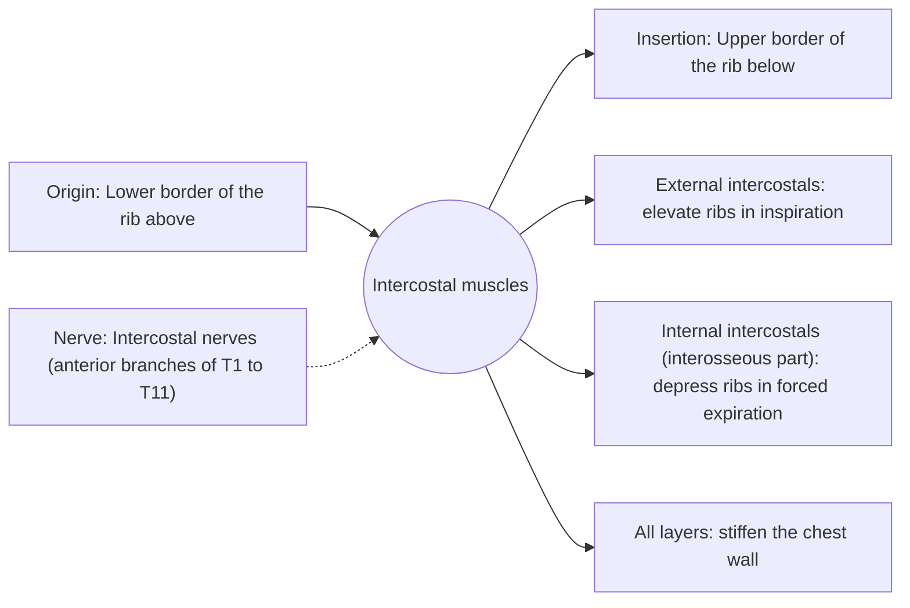

# Intercostal muscles

## Summary

The intercostal muscles fill the spaces between the ribs in three layers: external, internal and innermost. They stiffen the chest wall so it does not suck in during inspiration, and they help move the ribs in breathing: the external intercostals mainly in inspiration, the internal intercostals mainly in forced expiration. They are classic examples of synergists in breathing.

## Prerequisites

- [Muscular system overview](../muscular-system-overview.md)

## Core concepts

### Definition

The *intercostal muscles* are three thin layers in each of the 11 intercostal spaces. External fibers run down and forward; internal fibers run down and back, at right angles.

### Analogy

The intercostals are like the canvas between the poles of a fan. They keep the fan stiff so it can be opened and closed, and pulling on one direction of threads opens it (inspiration) while the crossing threads close it (expiration). The analogy breaks because the ribs also rotate at their joints with the spine.

### Mechanism

In quiet breathing, the diaphragm does most of the work, and the intercostals mainly stabilize. In exercise, they contribute more. The intercostal nerve, artery and vein run between the internal and innermost layers in the costal groove.

The diagram shows the attachments, the nerve and the actions.

### Attachments and innervation

| Feature | Description |
| --- | --- |
| Latin name | *musculi intercostales* |
| Origin | Lower border of the rib above |
| Insertion | Upper border of the rib below |
| Innervation | Intercostal nerves (anterior branches of T1 to T11) |
| Actions | External intercostals: elevate ribs in inspiration; Internal intercostals (interosseous part): depress ribs in forced expiration; All layers: stiffen the chest wall |

## Worked example

Pain on breathing and coughing after a hard bout of coughing or a twisting movement is often an intercostal muscle strain, felt between two ribs. It usually settles within weeks, but rib fracture and other causes need to be ruled out after trauma.

## Trade offs and when to use it

Thin, segmental muscles that make the chest wall both stable and mobile.

## Common mistakes

- **Thinking the intercostals are the main breathing muscles.** The diaphragm is the main muscle; intercostals assist and stabilize.

## Practice

1. Which intercostal layer helps forced expiration?
2. Where do the intercostal vessels and nerve run?

### Answers

1. The internal intercostals.
2. In the costal groove between the internal and innermost layers.

## Further reading

- Standring, S. (Ed.) (2020). *Gray's Anatomy: The Anatomical Basis of Clinical Practice (42nd ed.)*. Elsevier. Reference text for attachments, innervation and relations.
- Betts, J. G., Young, K. A., Wise, J. A. et al. (2022). *Anatomy and Physiology 2e*. OpenStax, Rice University. [Link](https://openstax.org/details/books/anatomy-and-physiology-2e). Open textbook with illustrations of the skeletal and muscular systems.
