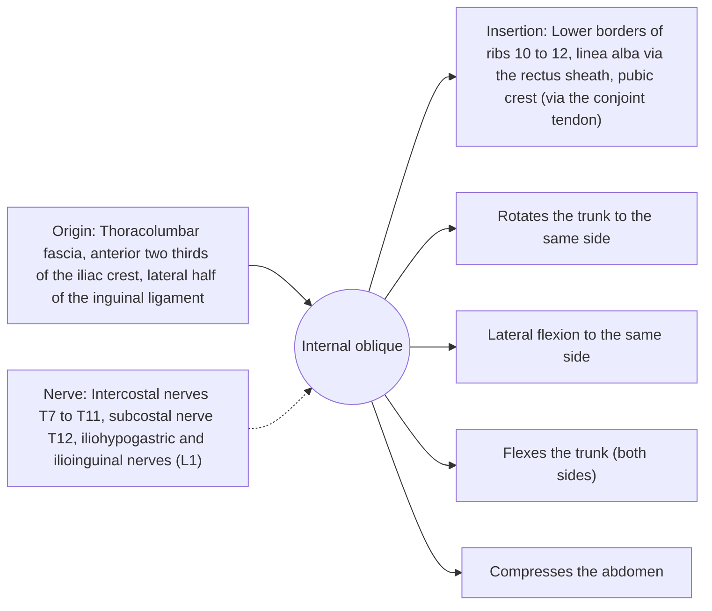

# Internal oblique

## Summary

The internal oblique lies under the external oblique, with fibers running up and forward, at right angles to it. It rotates the trunk to the same side, bends it to the same side and compresses the abdomen. It links to the back through the thoracolumbar fascia.

## Prerequisites

- [Muscular system overview](../muscular-system-overview.md)

## Core concepts

### Definition

The *internal oblique* is the middle of the three flat abdominal muscles, a fan-shaped sheet that spreads from the hip and lower back to the lower ribs and the rectus sheath.

### Analogy

If the external oblique is hands in front pockets, the internal oblique is hands on the chest crossed upward. Paired with the opposite external oblique, it forms one continuous diagonal sling around the trunk. The analogy breaks because the sling also attaches to the back through fascia, linking front and back.

### Mechanism

Its attachment to the thoracolumbar fascia lets it tension the fascia around the lumbar spine, adding stiffness. In the lower abdomen, its fibers and those of the transversus form the conjoint tendon and the cremaster muscle in men.

The diagram shows the attachments, the nerve and the actions.

### Attachments and innervation

| Feature | Description |
| --- | --- |
| Latin name | *musculus obliquus internus abdominis* |
| Origin | Thoracolumbar fascia, anterior two thirds of the iliac crest, lateral half of the inguinal ligament |
| Insertion | Lower borders of ribs 10 to 12, linea alba via the rectus sheath, pubic crest (via the conjoint tendon) |
| Innervation | Intercostal nerves T7 to T11, subcostal nerve T12, iliohypogastric and ilioinguinal nerves (L1) |
| Actions | Rotates the trunk to the same side; Lateral flexion to the same side; Flexes the trunk (both sides); Compresses the abdomen |

### Exercises and tests

The same rotational and anti-rotational exercises as the external oblique; side planks.

## Worked example

Throwing a ball with the right arm involves trunk rotation to the left, driven by the right external oblique and the left internal oblique. Diagonal chop exercises copy this pattern.

## Trade offs and when to use it

Contributes to rotation and to lumbar stability through fascia tension.

## Common mistakes

- **Thinking the internal and external obliques of the same side rotate in the same direction.** They rotate in opposite directions; each pairs with the opposite muscle of the other side.

## Practice

1. To which side does the right internal oblique rotate the trunk?
2. Which fascia links the internal oblique to the back?

### Answers

1. To the right.
2. The thoracolumbar fascia.

## Further reading

- Standring, S. (Ed.) (2020). *Gray's Anatomy: The Anatomical Basis of Clinical Practice (42nd ed.)*. Elsevier. Reference text for attachments, innervation and relations.
- Betts, J. G., Young, K. A., Wise, J. A. et al. (2022). *Anatomy and Physiology 2e*. OpenStax, Rice University. [Link](https://openstax.org/details/books/anatomy-and-physiology-2e). Open textbook with illustrations of the skeletal and muscular systems.
