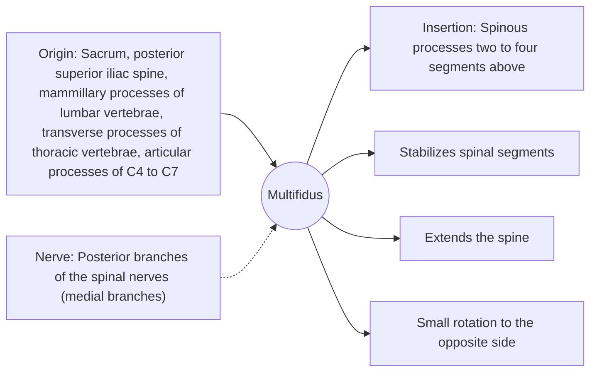

# Multifidus

## Summary

The multifidus is a series of short, deep muscle bundles running from vertebra to vertebra along the spine, thickest in the lumbar region. It stiffens individual spinal segments, controls small movements and extends the spine. After an episode of low back pain, the multifidus at the affected level often shrinks and responds more slowly.

## Prerequisites

- [Muscular system overview](../muscular-system-overview.md)

## Core concepts

### Definition

The *multifidus* belongs to the transversospinalis group of deep back muscles. Its bundles span two to four vertebrae, running from transverse or mammillary processes (or the sacrum) up to the spinous processes above.

### Analogy

The multifidus is like many short bolts tightening each joint of a segmented pole, while the erector spinae are the long cables. The bolts fine-tune the stiffness of each segment. The analogy breaks because the "bolts" can be weakened by pain and must be retrained.

### Mechanism

Because each bundle is short and attached close to the joints, the multifidus controls the position of each vertebra relative to the next. Each lumbar level is supplied by one medial branch, so its activity can be segment-specific.

The diagram shows the attachments, the nerve and the actions.

### Attachments and innervation

| Feature | Description |
| --- | --- |
| Latin name | *musculus multifidus* |
| Origin | Sacrum, posterior superior iliac spine, mammillary processes of lumbar vertebrae, transverse processes of thoracic vertebrae, articular processes of C4 to C7 |
| Insertion | Spinous processes two to four segments above |
| Innervation | Posterior branches of the spinal nerves (medial branches) |
| Actions | Stabilizes spinal segments; Extends the spine; Small rotation to the opposite side |

### Exercises and tests

Bird dog (opposite arm and leg lift on hands and knees), back extensions, deadlifts.

## Worked example

Ultrasound studies (for example by Hides and colleagues in the 1990s) showed a smaller multifidus cross-section at the painful level within days of a first episode of acute low back pain, and that it did not recover spontaneously in many people. Specific exercise restored its size and was associated with fewer recurrences in that trial.

## Trade offs and when to use it

A key segmental stabilizer, but evidence that specific multifidus training beats general exercise is mixed.

## Common mistakes

- **Assuming large back muscles alone protect the spine.** Deep segmental muscles like the multifidus control individual levels.

## Practice

1. Where is the multifidus thickest?
2. What happens to the multifidus after acute low back pain?

### Answers

1. In the lumbar region.
2. It often shrinks and activates later at the affected level.

## Further reading

- Standring, S. (Ed.) (2020). *Gray's Anatomy: The Anatomical Basis of Clinical Practice (42nd ed.)*. Elsevier. Reference text for attachments, innervation and relations.
- Betts, J. G., Young, K. A., Wise, J. A. et al. (2022). *Anatomy and Physiology 2e*. OpenStax, Rice University. [Link](https://openstax.org/details/books/anatomy-and-physiology-2e). Open textbook with illustrations of the skeletal and muscular systems.
