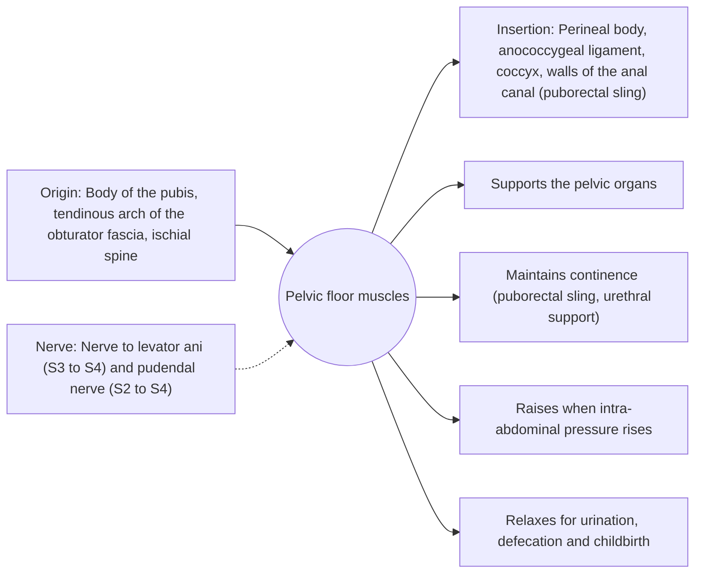

# Pelvic floor muscles

## Summary

The pelvic floor is a hammock of muscles closing the bottom of the pelvis. Its main parts are the levator ani (puborectalis, pubococcygeus, iliococcygeus) and the coccygeus. It supports the pelvic organs, helps keep urine and stool in, relaxes for emptying and childbirth, and forms the floor of the pressurized core.

## Prerequisites

- [Muscular system overview](../muscular-system-overview.md)

## Core concepts

### Definition

The *pelvic diaphragm* consists of the levator ani and the coccygeus. Together with the perineal muscles and fascia, it closes the pelvic outlet, with openings for the urethra, the anus and, in women, the vagina.

### Analogy

The pelvic floor is like the bottom of a hammock holding a heavy load. When pressure rises inside the abdomen, as when coughing, the hammock must tighten at the right moment or the load sags and the contents leak. The analogy breaks because the hammock can also deliberately relax to let things pass.

### Mechanism

The puborectalis loops around the anorectal junction and pulls it forward, creating an angle that helps hold stool. During coughing and lifting, the pelvic floor contracts reflexively. Pregnancy, vaginal birth, chronic straining, obesity and aging weaken it.

The diagram shows the attachments, the nerve and the actions.

### Attachments and innervation

| Feature | Description |
| --- | --- |
| Latin name | *diaphragma pelvis* |
| Origin | Body of the pubis, tendinous arch of the obturator fascia, ischial spine |
| Insertion | Perineal body, anococcygeal ligament, coccyx, walls of the anal canal (puborectal sling) |
| Innervation | Nerve to levator ani (S3 to S4) and pudendal nerve (S2 to S4) |
| Actions | Supports the pelvic organs; Maintains continence (puborectal sling, urethral support); Raises when intra-abdominal pressure rises; Relaxes for urination, defecation and childbirth |

### Exercises and tests

Pelvic floor muscle training (Kegel exercises): sets of contractions held for several seconds and quick contractions, practiced daily.

## Worked example

Stress urinary incontinence, leaking when coughing or jumping, is common after childbirth. Cochrane reviews find supervised pelvic floor muscle training effective for many women, and guidelines recommend at least three months of training as first-line treatment.

## Trade offs and when to use it

Must be strong enough for continence and relaxed enough for emptying and birth; both weakness and overactivity cause problems.

## Common mistakes

- **Practicing by stopping urine flow regularly.** This can disturb normal bladder emptying; use it only once to identify the muscles.

## Practice

1. Name the parts of the levator ani.
2. What is the first-line treatment for stress urinary incontinence?

### Answers

1. Puborectalis, pubococcygeus and iliococcygeus.
2. Supervised pelvic floor muscle training for at least three months.

## Further reading

- Standring, S. (Ed.) (2020). *Gray's Anatomy: The Anatomical Basis of Clinical Practice (42nd ed.)*. Elsevier. Reference text for attachments, innervation and relations.
- Betts, J. G., Young, K. A., Wise, J. A. et al. (2022). *Anatomy and Physiology 2e*. OpenStax, Rice University. [Link](https://openstax.org/details/books/anatomy-and-physiology-2e). Open textbook with illustrations of the skeletal and muscular systems.
