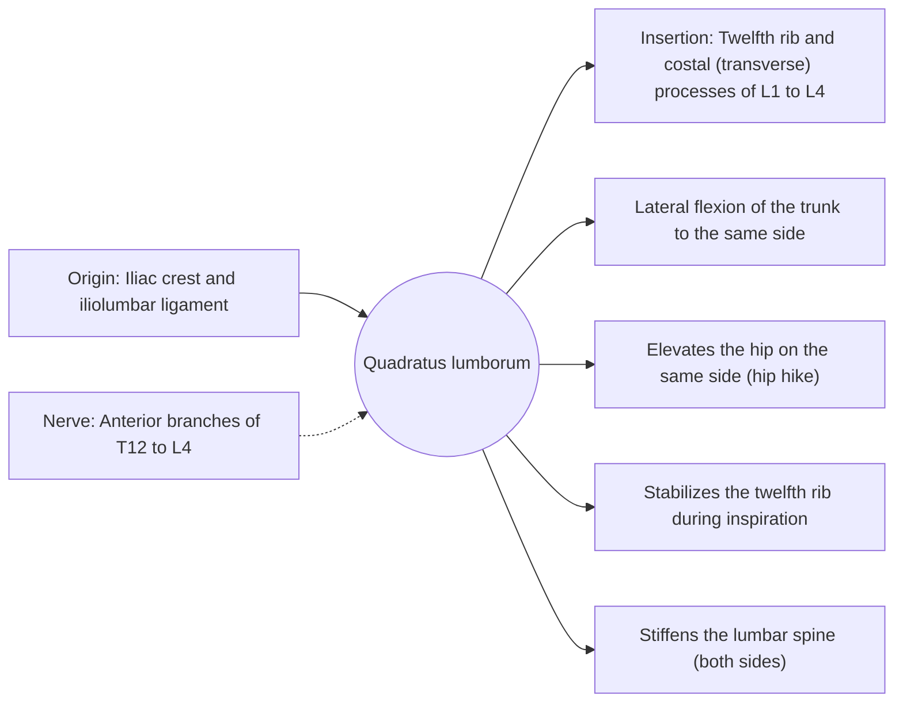

# Quadratus lumborum

## Summary

The quadratus lumborum is a flat, four-sided muscle in the back wall of the abdomen between the iliac crest and the twelfth rib. It bends the trunk to the side, hikes the hip, stabilizes the twelfth rib in breathing and stiffens the lumbar spine sideways. It works hard when carrying a heavy load in one hand.

## Prerequisites

- [Muscular system overview](../muscular-system-overview.md)

## Core concepts

### Definition

The *quadratus lumborum* lies deep in the lower back, beside the lumbar spine and behind the psoas.

### Analogy

The quadratus lumborum is like a guy rope between the pelvis and the lowest rib on each side of a tent pole. Pulling one rope tilts the pole or lifts the pelvis on that side. Both ropes together hold the pole steady. The analogy breaks because it also anchors the rib for the diaphragm.

### Mechanism

In a suitcase carry with a weight in the left hand, the right quadratus lumborum (with the right obliques) contracts to keep the trunk upright against the load trying to bend it to the left.

The diagram shows the attachments, the nerve and the actions.

### Attachments and innervation

| Feature | Description |
| --- | --- |
| Latin name | *musculus quadratus lumborum* |
| Origin | Iliac crest and iliolumbar ligament |
| Insertion | Twelfth rib and costal (transverse) processes of L1 to L4 |
| Innervation | Anterior branches of T12 to L4 |
| Actions | Lateral flexion of the trunk to the same side; Elevates the hip on the same side (hip hike); Stabilizes the twelfth rib during inspiration; Stiffens the lumbar spine (both sides) |

### Exercises and tests

Suitcase carries, side planks, side bends (with care).

## Worked example

Stuart McGill's research identified the side plank and the suitcase carry as exercises that strongly activate the quadratus lumborum with relatively low spinal compression, which is why they appear in many back rehabilitation programs.

## Trade offs and when to use it

A lateral stabilizer that is easily overloaded in asymmetric lifting.

## Common mistakes

- **Training only in the sagittal plane.** The quadratus lumborum is trained best with lateral and anti-lateral flexion work.

## Practice

1. Which muscle hikes the hip when walking with a stiff leg?
2. Which exercise loads the opposite quadratus lumborum?

### Answers

1. The quadratus lumborum.
2. A one-arm suitcase carry.

## Further reading

- Standring, S. (Ed.) (2020). *Gray's Anatomy: The Anatomical Basis of Clinical Practice (42nd ed.)*. Elsevier. Reference text for attachments, innervation and relations.
- Betts, J. G., Young, K. A., Wise, J. A. et al. (2022). *Anatomy and Physiology 2e*. OpenStax, Rice University. [Link](https://openstax.org/details/books/anatomy-and-physiology-2e). Open textbook with illustrations of the skeletal and muscular systems.
