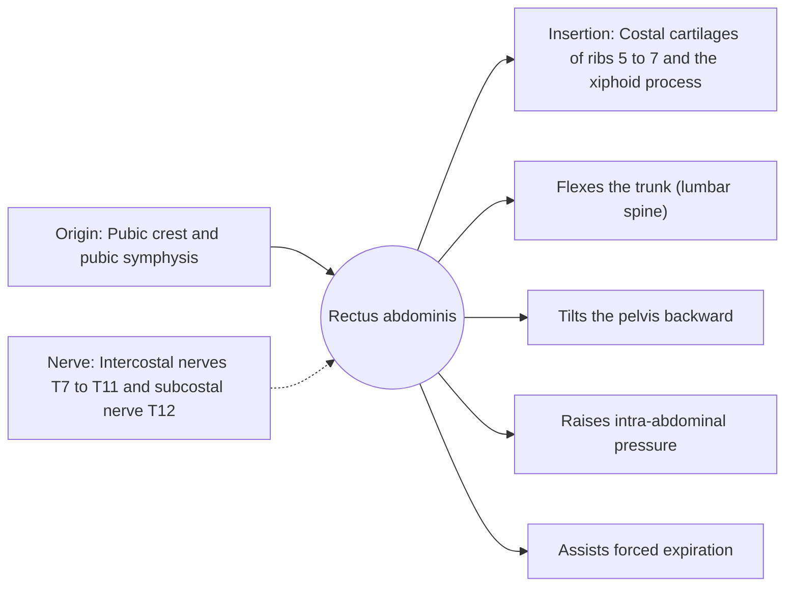

# Rectus abdominis

## Summary

The rectus abdominis is the long, paired, strap-like muscle at the front of the abdomen, the "six-pack". It flexes the trunk, tilts the pelvis backward and raises abdominal pressure. Tendinous bands divide it into segments, and the linea alba separates the left and right muscles.

## Prerequisites

- [Muscular system overview](../muscular-system-overview.md)

## Core concepts

### Definition

The *rectus abdominis* runs vertically on each side of the midline inside the rectus sheath, formed by the aponeuroses of the three flat abdominal muscles. Three or four tendinous intersections cross it.

### Analogy

The rectus abdominis is like a stack of linked plates on the front of a bending pole: shortening it curls the pole forward. The tendinous intersections are the rivets between plates, letting each segment contribute. The analogy breaks because the "six-pack" pattern is mostly genetic and only visible with low body fat.

### Mechanism

It is the main trunk flexor, active in sit-ups and crunches. When the trunk is fixed, it tilts the pelvis backward. It tenses during straining, coughing and lifting. Because it lies in front of the lumbar spine, it resists extension of the spine (see anti-extension exercises in [Anti-movements](../../../exercise-and-fitness/mobility/anti-movements.md)).

The diagram shows the attachments, the nerve and the actions.

### Attachments and innervation

| Feature | Description |
| --- | --- |
| Latin name | *musculus rectus abdominis* |
| Origin | Pubic crest and pubic symphysis |
| Insertion | Costal cartilages of ribs 5 to 7 and the xiphoid process |
| Innervation | Intercostal nerves T7 to T11 and subcostal nerve T12 |
| Actions | Flexes the trunk (lumbar spine); Tilts the pelvis backward; Raises intra-abdominal pressure; Assists forced expiration |

### Exercises and tests

Crunches, reverse crunches, hanging leg raises (with hip flexors), ab wheel rollouts and planks (as anti-extension).

## Worked example

During and after pregnancy, the linea alba between the two recti stretches and the muscles separate (diastasis recti). A gap of more than about two finger widths at the navel is common in the months after birth and often narrows with time and targeted exercise; physiotherapy assessment guides training.

## Trade offs and when to use it

A strong trunk flexor, but repeated loaded spinal flexion is not the only or necessarily the best way to train the abdominal wall; anti-extension and anti-rotation exercises train it as a stabilizer.

## Common mistakes

- **Believing crunches burn belly fat.** Local exercise does not remove fat from that area; visible abdominal muscles depend on overall body fat.

## Practice

1. Where does the rectus abdominis originate and insert?
2. What is diastasis recti?

### Answers

1. From the pubic crest and symphysis to the cartilages of ribs 5 to 7 and the xiphoid.
2. Separation of the two recti along a stretched linea alba, common after pregnancy.

## Further reading

- Standring, S. (Ed.) (2020). *Gray's Anatomy: The Anatomical Basis of Clinical Practice (42nd ed.)*. Elsevier. Reference text for attachments, innervation and relations.
- Betts, J. G., Young, K. A., Wise, J. A. et al. (2022). *Anatomy and Physiology 2e*. OpenStax, Rice University. [Link](https://openstax.org/details/books/anatomy-and-physiology-2e). Open textbook with illustrations of the skeletal and muscular systems.
