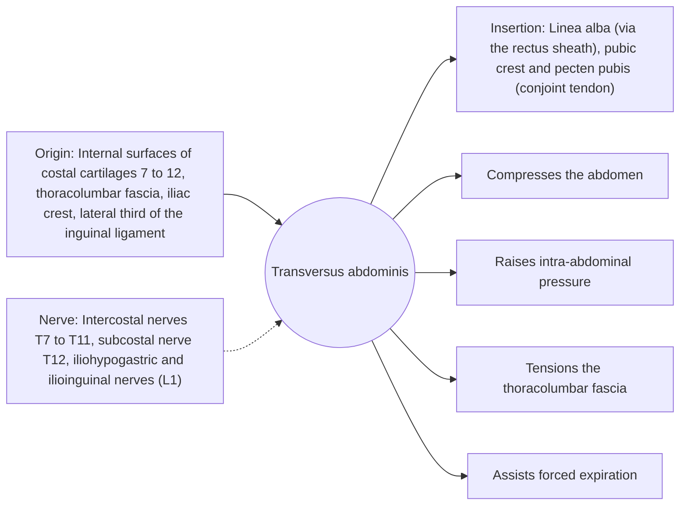

# Transversus abdominis

## Summary

The transversus abdominis is the deepest abdominal muscle, with fibers running horizontally around the abdomen like a belt. It does not move the trunk but compresses the abdomen and tensions the thoracolumbar fascia, which raises intra-abdominal pressure and stiffens the lumbar spine.

## Prerequisites

- [Muscular system overview](../muscular-system-overview.md)

## Core concepts

### Definition

The *transversus abdominis* is the innermost of the three flat abdominal muscles. Its aponeurosis joins the rectus sheath in front and the thoracolumbar fascia behind.

### Analogy

The transversus abdominis is like a weightlifting belt worn inside the body. Tightening it compresses the contents of the abdomen, which pushes up on the diaphragm and down on the pelvic floor and makes the trunk a stiff, pressurized cylinder. The analogy breaks because the "belt" can be tightened in small amounts while breathing normally.

### Mechanism

Research in the 1990s (Hodges and Richardson) found that the transversus contracts slightly before arm movements in people without back pain and with a delay in some people with back pain. This led to "drawing in" exercises. Later reviews found that specific transversus training is not superior to general exercise for back pain, and current views emphasize coordinated activity of all trunk muscles.

The diagram shows the attachments, the nerve and the actions.

### Attachments and innervation

| Feature | Description |
| --- | --- |
| Latin name | *musculus transversus abdominis* |
| Origin | Internal surfaces of costal cartilages 7 to 12, thoracolumbar fascia, iliac crest, lateral third of the inguinal ligament |
| Insertion | Linea alba (via the rectus sheath), pubic crest and pecten pubis (conjoint tendon) |
| Innervation | Intercostal nerves T7 to T11, subcostal nerve T12, iliohypogastric and ilioinguinal nerves (L1) |
| Actions | Compresses the abdomen; Raises intra-abdominal pressure; Tensions the thoracolumbar fascia; Assists forced expiration |

### Exercises and tests

Abdominal drawing-in (hollowing), bracing, dead bug variations, and most loaded lifts with proper bracing.

## Worked example

During a heavy squat, lifters take a breath and brace, contracting the transversus, obliques and diaphragm together. Intra-abdominal pressure rises sharply, which stiffens the trunk and helps transfer force from the legs to the bar. A lifting belt gives the muscles something to push against and raises this pressure further.

## Trade offs and when to use it

Provides stiffness without movement. Over-emphasis on isolated drawing-in has not proven better than general exercise.

## Common mistakes

- **Believing transversus training alone fixes back pain.** General exercise works about as well; coordinated bracing matters more than isolation.

## Practice

1. What is the main role of the transversus abdominis?
2. Does the transversus flex the trunk?

### Answers

1. Compressing the abdomen and stiffening the trunk through intra-abdominal pressure and fascia tension.
2. No, its horizontal fibers compress rather than move the trunk.

## Further reading

- Standring, S. (Ed.) (2020). *Gray's Anatomy: The Anatomical Basis of Clinical Practice (42nd ed.)*. Elsevier. Reference text for attachments, innervation and relations.
- Betts, J. G., Young, K. A., Wise, J. A. et al. (2022). *Anatomy and Physiology 2e*. OpenStax, Rice University. [Link](https://openstax.org/details/books/anatomy-and-physiology-2e). Open textbook with illustrations of the skeletal and muscular systems.
