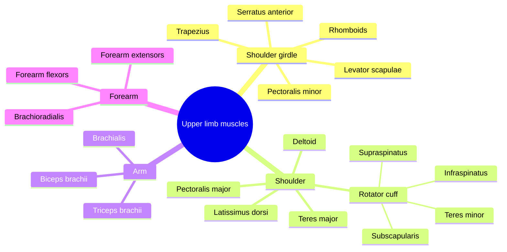

# Upper limb muscles

The muscles of the upper limb position the shoulder blade, move the arm at the shoulder, bend and straighten the elbow, turn the forearm and work the wrist and fingers. They are grouped here from the trunk outward.

## Map

## Reading order

Shoulder girdle:

1. [Trapezius](trapezius.md)
2. [Rhomboids](rhomboids.md)
3. [Levator scapulae](levator-scapulae.md)
4. [Serratus anterior](serratus-anterior.md)
5. [Pectoralis minor](pectoralis-minor.md)

Shoulder joint:

6. [Pectoralis major](pectoralis-major.md)
7. [Latissimus dorsi](latissimus-dorsi.md)
8. [Deltoid](deltoid.md)
9. [Rotator cuff](rotator-cuff.md), then [Supraspinatus](supraspinatus.md), [Infraspinatus](infraspinatus.md), [Teres minor](teres-minor.md) and [Subscapularis](subscapularis.md)
10. [Teres major](teres-major.md)

Arm and forearm:

11. [Biceps brachii](biceps-brachii.md)
12. [Brachialis](brachialis.md)
13. [Triceps brachii](triceps-brachii.md)
14. [Brachioradialis](brachioradialis.md)
15. [Forearm flexor muscles](forearm-flexors.md)
16. [Forearm extensor muscles](forearm-extensors.md)
