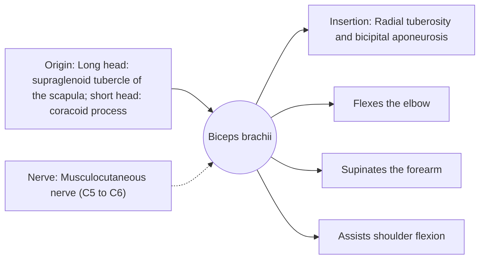

# Biceps brachii

## Summary

The biceps brachii is the two-headed muscle at the front of the upper arm. It flexes the elbow, supinates the forearm (turns the palm up) and helps flex the shoulder. It is strongest as an elbow flexor when the forearm is supinated. It is a two-joint muscle, crossing the shoulder and the elbow.

## Prerequisites

- [Muscular system overview](../muscular-system-overview.md)

## Core concepts

### Definition

The *biceps brachii* has a long head arising inside the shoulder joint and a short head from the coracoid process. The two bellies join and insert on the radius and, through a sheet of fascia (bicipital aponeurosis), on the forearm fascia.

### Analogy

The biceps is like a rope tied to the edge of a turntable (the radial tuberosity): pulling it first turns the turntable (supination) and then lifts it (elbow flexion). This is why the biceps works best for curling with the palm up. The analogy breaks because the "rope" also crosses the shoulder.

### Mechanism

With the forearm pronated, the biceps tendon is wrapped around the radius and its flexion lever arm shrinks, so the brachialis and brachioradialis do more of the work.

The diagram shows the attachments, the nerve and the actions.

### Attachments and innervation

| Feature | Description |
| --- | --- |
| Latin name | *musculus biceps brachii* |
| Origin | Long head: supraglenoid tubercle of the scapula; short head: coracoid process |
| Insertion | Radial tuberosity and bicipital aponeurosis |
| Innervation | Musculocutaneous nerve (C5 to C6) |
| Actions | Flexes the elbow; Supinates the forearm; Assists shoulder flexion |

### Exercises and tests

Curls (barbell, dumbbell, incline for a stretched position), chin-ups.

## Worked example

A distal biceps tendon rupture causes a sudden pop at the elbow when lifting a heavy load with a bent elbow, and the muscle belly moves up ("Popeye sign" is more typical of the long head rupture at the shoulder). Distal ruptures cause marked loss of supination strength and are often repaired surgically in active people.

## Trade offs and when to use it

A visible "show" muscle, but the brachialis does more elbow flexion work in many positions.

## Common mistakes

- **Thinking the biceps is the main elbow flexor in every position.** The brachialis is the main flexor; the biceps dominates with the palm up.

## Practice

1. Which nerve supplies the biceps?
2. Name two actions of the biceps besides elbow flexion.

### Answers

1. The musculocutaneous nerve.
2. Supination of the forearm and assisting shoulder flexion.

## Further reading

- Standring, S. (Ed.) (2020). *Gray's Anatomy: The Anatomical Basis of Clinical Practice (42nd ed.)*. Elsevier. Reference text for attachments, innervation and relations.
- Betts, J. G., Young, K. A., Wise, J. A. et al. (2022). *Anatomy and Physiology 2e*. OpenStax, Rice University. [Link](https://openstax.org/details/books/anatomy-and-physiology-2e). Open textbook with illustrations of the skeletal and muscular systems.
