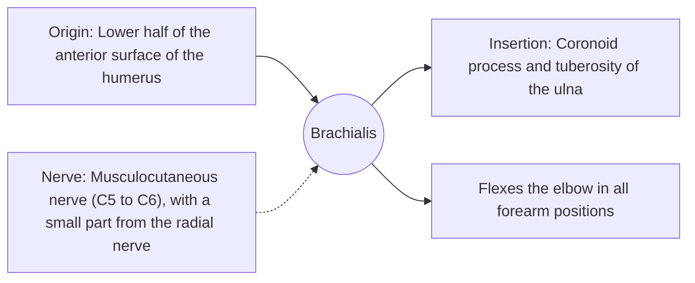

# Brachialis

## Summary

The brachialis lies under the biceps on the front of the lower humerus and inserts on the ulna. It is the main flexor of the elbow in every forearm position, because the ulna does not rotate. It is a classic example of a synergist of the biceps.

## Prerequisites

- [Muscular system overview](../muscular-system-overview.md)

## Core concepts

### Definition

The *brachialis* is a broad, flat single-joint muscle of the anterior arm.

### Analogy

The brachialis is the workhorse under the show horse: the biceps gets the attention, but the brachialis pulls in every curl, whether the palm faces up, down or sideways. The analogy breaks because it is visible too, pushing the biceps up and out when developed.

### Mechanism

Because it inserts on the ulna, which does not rotate in pronation and supination, its lever arm is the same whatever the hand position.

The diagram shows the attachments, the nerve and the actions.

### Attachments and innervation

| Feature | Description |
| --- | --- |
| Latin name | *musculus brachialis* |
| Origin | Lower half of the anterior surface of the humerus |
| Insertion | Coronoid process and tuberosity of the ulna |
| Innervation | Musculocutaneous nerve (C5 to C6), with a small part from the radial nerve |
| Actions | Flexes the elbow in all forearm positions |

### Exercises and tests

Hammer curls, reverse curls, any elbow flexion.

## Worked example

After a severe elbow injury, the brachialis can calcify (myositis ossificans) if it is massaged aggressively or stretched too early. Elbow injuries are therefore mobilized gently.

## Trade offs and when to use it

Reliable flexor, rarely injured on its own.

## Common mistakes

- **Ignoring hand position.** Reverse and hammer curls shift work toward the brachialis and brachioradialis.

## Practice

1. Why is the brachialis effective in every forearm position?
2. Which nerve mainly supplies it?

### Answers

1. It inserts on the ulna, which does not rotate.
2. The musculocutaneous nerve.

## Further reading

- Standring, S. (Ed.) (2020). *Gray's Anatomy: The Anatomical Basis of Clinical Practice (42nd ed.)*. Elsevier. Reference text for attachments, innervation and relations.
- Betts, J. G., Young, K. A., Wise, J. A. et al. (2022). *Anatomy and Physiology 2e*. OpenStax, Rice University. [Link](https://openstax.org/details/books/anatomy-and-physiology-2e). Open textbook with illustrations of the skeletal and muscular systems.
