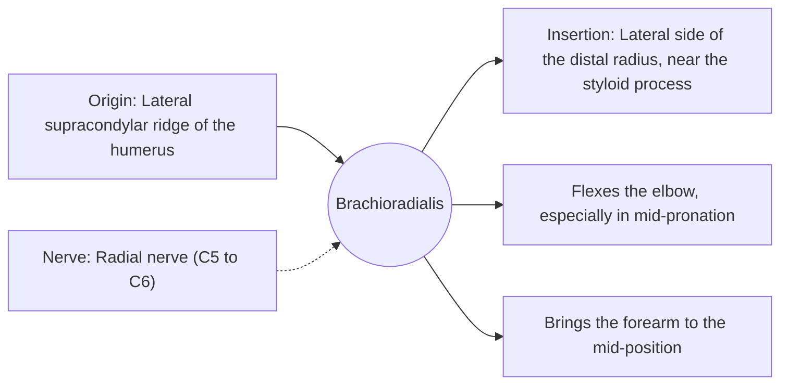

# Brachioradialis

## Summary

The brachioradialis is the forearm muscle running from the lower humerus to the wrist end of the radius. It flexes the elbow, most strongly with the forearm in mid-position (thumb up), and is a typical synergist in elbow flexion.

## Prerequisites

- [Muscular system overview](../muscular-system-overview.md)

## Core concepts

### Definition

The *brachioradialis* is the most superficial muscle on the thumb side of the forearm. Although it flexes the elbow, it is supplied by the radial nerve, which normally supplies extensors.

### Analogy

The brachioradialis is like a long lever attached far from the hinge: it lifts quickly rather than with great force at small angles, and acts best with the hand in a neutral "hammer" grip. The analogy breaks because it also returns the forearm toward the mid-position from full pronation or supination.

### Mechanism

It forms the lateral border of the cubital fossa. It is most active in rapid elbow flexion and against load with the thumb up.

The diagram shows the attachments, the nerve and the actions.

### Attachments and innervation

| Feature | Description |
| --- | --- |
| Latin name | *musculus brachioradialis* |
| Origin | Lateral supracondylar ridge of the humerus |
| Insertion | Lateral side of the distal radius, near the styloid process |
| Innervation | Radial nerve (C5 to C6) |
| Actions | Flexes the elbow, especially in mid-pronation; Brings the forearm to the mid-position |

### Exercises and tests

Hammer curls, reverse curls, rope curls.

## Worked example

The brachioradialis reflex is tested by tapping the tendon near the wrist; it checks the C5 and C6 nerve roots and is part of a standard neurological examination.

## Trade offs and when to use it

Useful synergist; overuse in repetitive gripping with the thumb up contributes to forearm pain.

## Common mistakes

- **Classifying it as an extensor because of its nerve.** It is innervated by the radial nerve but flexes the elbow.

## Practice

1. In which forearm position is the brachioradialis strongest?
2. Which nerve root levels does its reflex test?

### Answers

1. The mid-position (thumb up).
2. C5 and C6.

## Further reading

- Standring, S. (Ed.) (2020). *Gray's Anatomy: The Anatomical Basis of Clinical Practice (42nd ed.)*. Elsevier. Reference text for attachments, innervation and relations.
- Betts, J. G., Young, K. A., Wise, J. A. et al. (2022). *Anatomy and Physiology 2e*. OpenStax, Rice University. [Link](https://openstax.org/details/books/anatomy-and-physiology-2e). Open textbook with illustrations of the skeletal and muscular systems.
