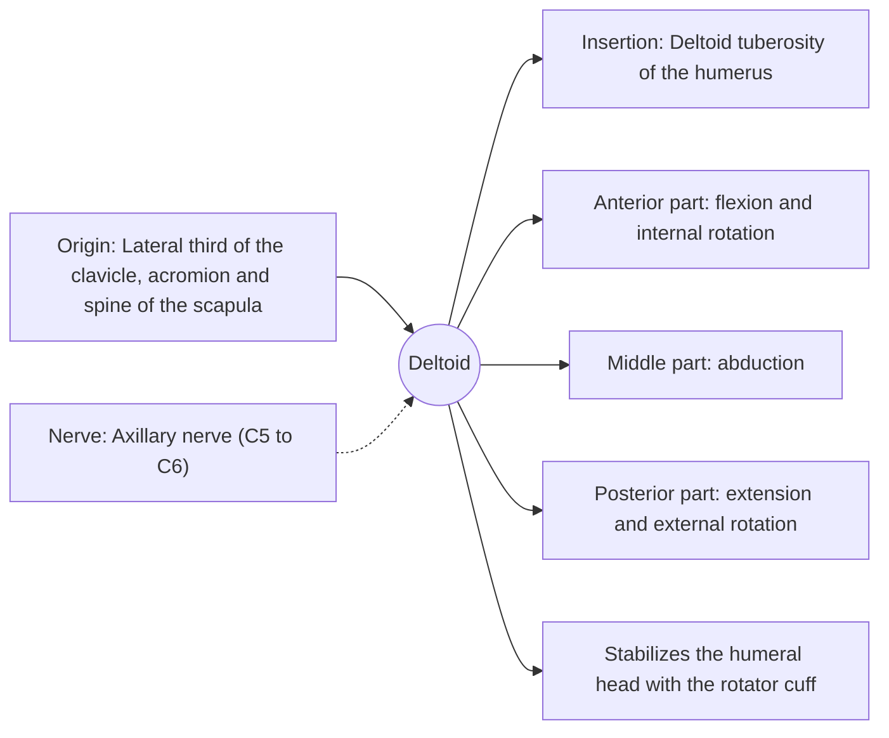

# Deltoid

## Summary

The deltoid is the thick, triangular muscle that caps the shoulder and gives it its round shape. Its anterior, middle and posterior parts flex, abduct and extend the arm. The middle part is the main abductor once the arm is away from the side.

## Prerequisites

- [Muscular system overview](../muscular-system-overview.md)

## Core concepts

### Definition

The *deltoid* has clavicular (anterior), acromial (middle) and spinal (posterior) parts that converge on the deltoid tuberosity of the humerus.

### Analogy

The deltoid is like three ropes over the top of a pole, from the front, the top and the back: pulling the front rope swings the arm forward, the side rope lifts it sideways and the back rope swings it back. The analogy breaks because the middle part is multipennate, packing many short fibers for force.

### Mechanism

At the start of abduction the deltoid pulls the humeral head upward; the rotator cuff (especially supraspinatus) presses the head into the socket, which lets the deltoid lift the arm without the head jamming against the acromion.

The diagram shows the attachments, the nerve and the actions.

### Attachments and innervation

| Feature | Description |
| --- | --- |
| Latin name | *musculus deltoideus* |
| Origin | Lateral third of the clavicle, acromion and spine of the scapula |
| Insertion | Deltoid tuberosity of the humerus |
| Innervation | Axillary nerve (C5 to C6) |
| Actions | Anterior part: flexion and internal rotation; Middle part: abduction; Posterior part: extension and external rotation; Stabilizes the humeral head with the rotator cuff |

### Exercises and tests

Overhead presses (anterior and middle), lateral raises (middle), rear delt flies and face pulls (posterior).

## Worked example

The axillary nerve wraps around the surgical neck of the humerus. After a shoulder dislocation or neck fracture, numbness over a patch of skin on the outer upper arm ("regimental badge" area) and weak abduction suggest axillary nerve injury.

## Trade offs and when to use it

Strong and versatile, but depends on the rotator cuff to center the joint.

## Common mistakes

- **Training only the front deltoid with presses.** The middle and posterior parts need lateral and rear movements.

## Practice

1. Which nerve supplies the deltoid?
2. Which part of the deltoid is the main abductor?

### Answers

1. The axillary nerve.
2. The middle (acromial) part.

## Further reading

- Standring, S. (Ed.) (2020). *Gray's Anatomy: The Anatomical Basis of Clinical Practice (42nd ed.)*. Elsevier. Reference text for attachments, innervation and relations.
- Betts, J. G., Young, K. A., Wise, J. A. et al. (2022). *Anatomy and Physiology 2e*. OpenStax, Rice University. [Link](https://openstax.org/details/books/anatomy-and-physiology-2e). Open textbook with illustrations of the skeletal and muscular systems.
