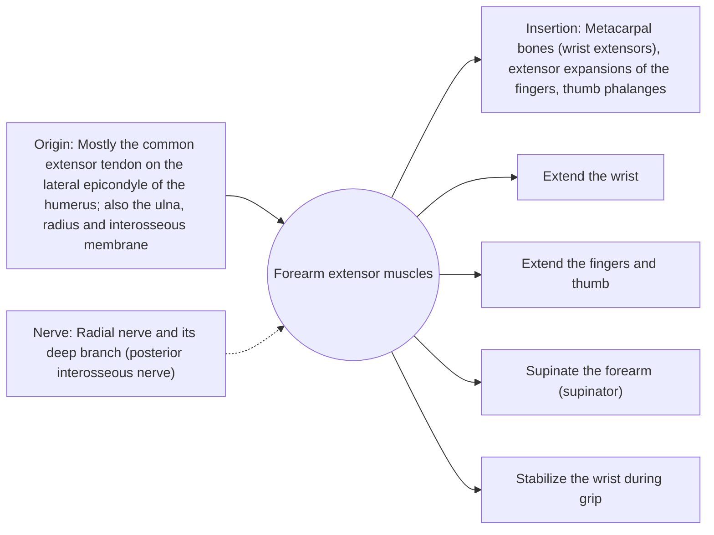

# Forearm extensor muscles

## Summary

The forearm extensors are a group of muscles on the back of the forearm, most arising from the lateral epicondyle of the humerus. They extend the wrist and fingers, help supinate the forearm and stabilize the wrist during gripping. Overuse at their common origin causes tennis elbow.

## Prerequisites

- [Muscular system overview](../muscular-system-overview.md)

## Core concepts

### Definition

The *posterior forearm compartment* contains superficial muscles (extensor carpi radialis longus and brevis, extensor digitorum, extensor digiti minimi, extensor carpi ulnaris, anconeus) and deep muscles (supinator, abductor pollicis longus, extensor pollicis brevis and longus, extensor indicis).

### Analogy

The forearm extensors are like the springs that hold a door open while you push through it: when you grip, they keep the wrist from bending forward so the finger flexors can pull hard. The analogy breaks because they also move the fingers in their own right.

### Mechanism

Every firm grip activates the wrist extensors, especially the extensor carpi radialis brevis, to stop the finger flexors from also flexing the wrist. This is why gripping hurts in tennis elbow.

The diagram shows the attachments, the nerve and the actions.

### Attachments and innervation

| Feature | Description |
| --- | --- |
| Latin name | *musculi extensores antebrachii* |
| Origin | Mostly the common extensor tendon on the lateral epicondyle of the humerus; also the ulna, radius and interosseous membrane |
| Insertion | Metacarpal bones (wrist extensors), extensor expansions of the fingers, thumb phalanges |
| Innervation | Radial nerve and its deep branch (posterior interosseous nerve) |
| Actions | Extend the wrist; Extend the fingers and thumb; Supinate the forearm (supinator); Stabilize the wrist during grip |

### Exercises and tests

Reverse wrist curls, eccentric wrist extension with a dumbbell or a flexible bar.

## Worked example

Tennis elbow (lateral epicondylalgia) affects about 1 to 3 percent of adults each year, mostly not tennis players. Most cases resolve within a year. Corticosteroid injections relieve pain short term but are associated with worse outcomes at one year compared with waiting or physiotherapy in trials.

## Trade offs and when to use it

Wrist extensors protect the grip but carry constant load in keyboard and tool work.

## Common mistakes

- **Relying on repeated steroid injections for tennis elbow.** They help short term but may worsen longer-term outcomes; loading programs are preferred.

## Practice

1. From which landmark do most forearm extensors arise?
2. Why does gripping hurt in tennis elbow?

### Answers

1. The lateral epicondyle of the humerus.
2. Gripping activates the wrist extensors to stabilize the wrist, loading their irritated common tendon.

## Further reading

- Standring, S. (Ed.) (2020). *Gray's Anatomy: The Anatomical Basis of Clinical Practice (42nd ed.)*. Elsevier. Reference text for attachments, innervation and relations.
- Betts, J. G., Young, K. A., Wise, J. A. et al. (2022). *Anatomy and Physiology 2e*. OpenStax, Rice University. [Link](https://openstax.org/details/books/anatomy-and-physiology-2e). Open textbook with illustrations of the skeletal and muscular systems.
